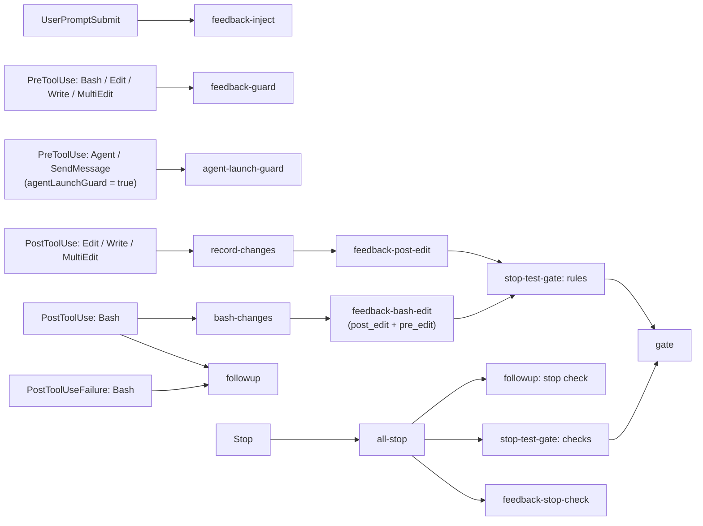

# feedback-gate

[English](README.md)

function hooks で作られた Claude Code プラグインです。次の 3 つを行います。

- フィードバックルール（`~/.claude/feedback/*.md`）を各プロンプトに注入し、ツール呼び出し時と停止時に強制する。
- プロジェクトごとの品質ゲート（lint・テストなど、`.claude/gate.yaml` で定義）を、ファイル編集後と停止時に実行する。
- 確認待ちのときと停止時にデスクトップ通知を出す（macOS）。

## フック

フックは `src/register.ts` で登録され（CI が `hooks/register.js` にバンドルし、それを Claude Code が読み込みます）、`src/` の TypeScript モジュールを呼びます。

| イベント | モジュール | 役割 |
| --- | --- | --- |
| SessionStart | `src/reset-gate.ts`、`src/followup.ts`（`resetFollowups`） | `startup` / `clear` のときだけ自セッションのゲート状態と保留中の後続コマンドを消す。resume / compact では消さない。 |
| UserPromptSubmit | `src/rules-file.ts` + `src/feedback-inject.ts` | ルールファイル（`rulesFile` のファイルがあればそれ、無ければ同梱の `rules/feedback_rules.md`。言語が英語なら `rules/feedback_rules.en.md`）と確定済みフィードバックルール（`count >= 3`）をコンテキストに追加する。 |
| PreToolUse（Bash / Edit / Write / MultiEdit） | `src/feedback-guard.ts` | `pre_bash` / `pre_edit` の enforce を評価し、`count` に応じて deny / ask / warn する。 |
| PostToolUse（Write / Edit / MultiEdit） | `src/record-changes.ts` → `src/feedback-post-edit.ts` → `src/stop-test-gate.ts`（`rules`） | 変更ファイルを記録し、`post_edit` の enforce を編集後のファイル全体に対して評価（`count` に応じて block / warn）したあと、`.claude/gate.yaml` の該当ルールを実行する（`src/gate.ts` 経由）。 |
| PreToolUse（Bash） | `src/bash-changes.ts`（`bashStarted`）。`feedback-guard` の前。続けて `src/followup.ts`（`followupGuard`） | 保留中の[後続コマンド](#follow-up-commands)を `run_in_background: true` 無しで起動しようとしたら deny し、背景で打ち直させる。コマンドの開始時刻を控える（`bash_started.<session>--<tool_use_id>.json`）。`.claude/gate.yaml` があるプロジェクトでは `.claude/.gate-status/` に、無いプロジェクトでは `~/.claude/feedback/.bash_started/`（`.ask_state` と同じ feedback 側の状態置き場）に置く。後者は `post_edit` / `pre_edit` の enforce を持つ有効な feedback ルールがあるときだけで、`gate.yaml` の無いプロジェクトの作業ツリーには状態ファイルを作らない。 |
| PostToolUse（Bash） | `src/bash-changes.ts` → `src/feedback-bash-edit.ts` → `src/stop-test-gate.ts`（`rules`）→ `src/followup.ts`（`followupAfterBash`） | コマンドが実際に書き換えたファイル（cwd の作業ツリーと `.claude/worktrees/` 配下の各 worktree で、git の変更・未追跡ファイルと、コマンド中に作られたコミットが触ったファイルのうち、mtime がコマンド開始以降のもの）を拾う。heredoc・`python`・`sed -i` などで書いても、Edit / Write に掛かる検査が抜けないようにするため。各ファイルを、Edit / Write の後と同じく `post_edit` の enforce でファイル全体に対して評価し、実行後に判定できる `pre_edit` の enforce（下記）も評価して、全ファイルの結果を 1 つの block / warn にまとめる。そのあと `.claude/gate.yaml` があるときだけ変更ファイルとして記録し、記録があれば該当ルールを実行する。feedback の検査は `gate.yaml` が無くても動く。git の履歴・作業ツリー操作（rebase / checkout / merge など）は検査も記録もしない。最後に[後続コマンド](#follow-up-commands): コマンドが定義したきっかけに一致したら、後続コマンド（hook が埋められた引数は埋めたもの）をバックグラウンドで実行するよう Claude に求める。コマンドが保留中の後続コマンドだったなら起動済みにする。 |
| PostToolUseFailure（Bash） | `src/followup.ts`（`followupAfterBashFailure`） | 失敗した（非 0 終了の）コマンドが保留中の後続コマンドだったとき、エラーを見てコマンドを組み立て直して再実行するか、失敗を結果として報告するよう Claude に伝える。`max_attempts` 回で打ち切る。 |
| PreToolUse（Agent / SendMessage）、任意 | `src/agent-launch-guard.ts` | `agentLaunchGuard` が `true` のときだけ有効。サブエージェントへ指示を送る前に、送信本文を見せて確認する。 |
| Notification | `src/notification.ts`（`notify`） | 確認待ちのときにデスクトップ通知（`terminal-notifier` が必要、macOS）。 |
| Stop | `src/all-stop.ts` | 後続コマンドの確認（`src/followup.ts`。一度も起動されていない後続コマンドがある間はブロック）、ゲートの `checks` フェーズ（直っていない rules の失敗を再実行し、予約された consistency checks を実行）、`src/feedback-stop-check.ts`、`stop` 通知を順に実行する。 |
| SubagentStop | 後続コマンドの確認、ゲートの `checks` フェーズ、`src/feedback-stop-check.ts`、続けて `src/subagent-report.ts`（`saveSubagentReport`） | サブエージェント向けの同じ後続コマンドの確認・ゲート・`stop_check` ルール（サブエージェントの中で発火した後続コマンドはそのサブエージェントが実行する）。結果は呼び出し元のエージェントへ渡すために控えます（[サブエージェントの結果](#results-of-subagents)）。 |
| PostToolUse（Agent） | `src/subagent-report.ts`（`subagentReport`） | 終わったサブエージェントの gate / `stop_check` の結果を、呼び出し元のエージェントの context に追加します。 |

### Bash で書いたファイル

Bash コマンドは、実行前には何が書かれるか分からないので、`pre_edit` を PreToolUse で評価できません。代わりにコマンドの実行後、`src/feedback-bash-edit.ts` が書き換えられた各ファイルに `pre_edit` を同じ条件で評価します: `path` / `exclude_path`、`absent_sibling` / `absent_glob`（コマンド終了時点でテストファイルがあればよいので、同じコマンドでテストも書けば通る）、そして `when` / `unless` はそのコマンドが書いた内容に対して（git が追跡しているファイルなら `HEAD` との差分の追加行。同じコマンドでコミット済みなら、開始以降のコミットの追加行。追跡外のファイル（新規作成や git の外）なら Write の `content` と同じく全文）。書き込みは済んでいるので、`deny` / `ask` は PostToolUse の `block`（ファイルを直させる）になり、メッセージに「実行後に検知した」旨が付きます。同じセッション・同じルール・同じファイルで既に `ask` したものは、Edit と同じく `warn` に落とします。警告・block にはファイルのパスが付きます。検査の対象は git が列挙できるファイル（追跡中か、未追跡で ignore されていないもの）だけで、git の作業ツリーの外や `.gitignore` されたファイルへの書き込みは検査されません。

### サブエージェントの結果

<a id="results-of-subagents"></a>サブエージェントの SubagentStop で走った gate と `stop_check` の結果は、サブエージェント自身（block の reason）かユーザー（`systemMessage`）にしか届きません。呼び出し元のエージェントにはサブエージェントの最後の発言しか見えないため、検証が通ったかを知るには gate のログを読む必要がありました。そこで SubagentStop のたびにその回の結果を、プロジェクトの他の状態ファイルと同じ `.claude/.gate-status/subagent_report.<session>--<agent>.json` に控え（`gate.yaml` が無い PJ では `stop_check` が何か見つけたときだけ）、呼び出し元の `Agent` の PostToolUse で、ツール結果の `agentId` のファイルを context に追加して消します。例:

```
[feedback-gate] サブエージェント code-implementer (a1b2c3) の停止時に実行された hook（gate の検証と feedback の stop_check）の結果です。gate のログを読んだり検証を再実行したりせず、これを使ってください:
[gate] 検証がすべて通りました: lint ✓ / typecheck ✓ / test ✓
```

渡すのは最後の SubagentStop（サブエージェントが実際に止まった回）の結果です: `[gate] 検証がすべて通りました: ...`、`checks` フェーズの要約、または `MAX_ATTEMPTS` 回で打ち切ったときの失敗の内容と、`stop_check` の warn（またはその打ち切り）。成功報告の直後の Stop は gate のコマンドを実行しないので、直前の回の「検証がすべて通りました」を残します。何も実行されず何も見つからなかったときは何も追加しません。バックグラウンドで起動したサブエージェントは PostToolUse の後に終わるため、結果は渡されません。そうして残ったファイルは、他の状態ファイルと同じくセッション開始時の `reset-gate` が消します（`startup` / `clear`、または 24 時間超）。

### 後続コマンド

<a id="follow-up-commands"></a>`src/followup.ts`。Bash のコマンドが、定義ファイルに書いたきっかけに一致したら、そこに書いた後続コマンドをバックグラウンドで実行し、その結果が Claude に返ります。典型は `gh pr create` のあとに、作った PR の番号で `gh pr checks <番号> --watch` を走らせる場合です。Claude Code 自身のバックグラウンド実行はコマンドを Claude が決めるので見当違いなことがありますが、ここではきっかけとコマンドは人間が書き、`{{...}}` の引数だけを埋めます。

役割分担:

- **引数**: `args` に `pattern` のある引数は、hook がきっかけのコマンドの出力（PostToolUse の `tool_response`）かコマンド自体から取り出して埋め、埋めたコマンドと取り出した値を Claude に渡します。hook で埋まらない引数だけを Claude が出力から推測します（hook はモデルを呼べません）。pattern が一致しなかったときや、埋めた値が出力と食い違っているときの修正は Claude の仕事です。文面で定義ファイルの場所を示し、正しい値で実行したうえでその `pattern` を出力に一致する形に直し、変更内容をあなたに伝えるよう求めます。hook が引数を埋めたバックグラウンド実行の開始時にも、引数の誤りで失敗したときは同じように直すよう添えます。
- **実行**: Claude が Bash ツールで、必ず `run_in_background: true` で実行します。保留中の後続コマンドを前景で打とうとすると PreToolUse で deny され、背景で打ち直すよう指示されます。前景だと Bash ツールの時間制限（最長 10 分）で `gh pr checks --watch` のような長い待ちが途中で切られることがあります。バックグラウンドのタスクは Claude Code の上限（既定 30 分、`timeout` で最長 2 時間）です。
- **結果**: バックグラウンドのタスクが終わると、Claude Code 自身が出力を Claude に渡し、待機中でも起こします（task notification）。hook はここに関与せず、Stop も走っている後続コマンドを待ちません（待つとその間あなたが何もできなくなるため）。
- **強制**: hook は後続コマンドが起動されるまで保留にし、一度も起動されていない保留がある間は Stop をブロックします（3 回続けてブロックしたら取り下げ）。起動されたかは、コマンドの形（各 `{{...}}` はシェルの 1 語か引用符付きの文字列、空白は任意の空白列、`cd x && ...` や `2>&1` のような前後の付け足しも可）に一致するコマンドが背景で始まったか前景で成功したかで見ます。起動自体が失敗したら（PostToolUseFailure）試行回数とともに、エラーからコマンドを組み立て直すか、コマンドが正しければ失敗を結果として報告するよう伝え、`max_attempts` 回で保留を消します。バックグラウンドの実行が引数の誤りで失敗した場合は hook には見えないので、起動時の文面で「その場合は組み立て直して再実行せよ」と伝えておきます。

定義ファイルは `~/.claude/followup/*.md`（グローバル）と `<project>/.claude/followup/*.md`（プロジェクト。同じ `name` ならプロジェクト側が優先）で、1 ファイル 1 件です:

```markdown
---
name: pr_checks                     # 任意。省略時はファイル名
description: PR を作ったら CI を見届ける
when: '^gh pr create\b'             # 必須。Bash のコマンドにマッチする正規表現（pre_bash と同じ Python re の書き方）
unless: '--dry-run'                 # 任意。マッチしたら発火しない
run: 'gh pr checks {{pr}} --watch'  # 必須。後続コマンド。{{name}} が引数
args:                               # 任意。引数ごとの埋め方
  pr:                               #   辞書なら hook が埋める: pattern（正規表現。最初のキャプチャ、無ければ一致全体）を
    from: output                    #   from（output = きっかけのコマンドの出力、既定。command = きっかけのコマンド）に当てる。
    pattern: 'pull/(\d+)'           #   値はシェルの 1 語として引用符で守られる（雛形の穴を引用符で囲まないこと）
    hint: PR の番号                  #   hint は取れなかったとき Claude に見せる説明
  repo: owner/name の形              #   文字列なら Claude に見せる説明だけ（Claude が埋める）
timeout: 3600                       # 任意。秒。Bash の timeout として指定するよう Claude に伝える（省略時は Claude Code の既定）
max_attempts: 3                     # 任意。起動の失敗を何回で打ち切るか（既定 3）
---

任意の本文: そのまま Claude に渡す補足の指示。
```

`expires`・`projects`・`when_exists` は feedback ルールと同じに働きます。壊れたファイル（frontmatter が読めない、`when` / `run` が無い、`when` / `unless` / `args.*.pattern` が使えない正規表現）はそのファイルだけを飛ばし、`~/.claude/feedback/.errors.jsonl` に記録します。

Claude に見えるものを順に: きっかけのコマンドの PostToolUse(Bash) で `[followup] ... を実行したので、続けて次の後続コマンドを実行してください（pr_checks: ...）。引数は埋めてあるので、このまま実行してください:` に続けてコマンド（推測が残るときは雛形・`args` の説明・本文）と、`run_in_background: true` で実行せよという指示。前景で打とうとしたときは deny の理由。背景で起動したときは `[followup] 後続コマンド ... をバックグラウンドで開始しました。待たずに作業を続けてください。完了すると Claude Code が結果を渡すので、それをユーザーに報告してください。`。起動しないまま終了しようとしたときは、保留中のコマンドの一覧をブロックの理由として。サブエージェントの中で発火した後続コマンドはそのサブエージェントが起動します。PreToolUse のイベントにはエージェント ID が入らないので、deny の判定はセッションの全エージェントの保留を見ます。後続コマンド自身は同じ定義を再発火させませんが、別の定義のきっかけにはなるので、後続コマンドを連鎖させられます。

保留は `~/.claude/followup/.pending/<session>[--<agent>].json` に置き、SessionStart（`startup` / `clear`）と 24 時間経過で消します。ディレクトリ（定義と状態）は `CLAUDE_FOLLOWUP_DIR` で変更できます。

### エージェント起動ガード（任意）

`src/agent-launch-guard.ts` は、`userConfig` の `agentLaunchGuard` を `true` にしたときだけ有効になります（既定は `false`）。有効にすると、`Agent` と `SendMessage` の PreToolUse で `ask` を返し、送信しようとしている本文を確認理由にそのまま載せるので、サブエージェントに渡る前に内容を確認できます。

- `Agent`: `subagent_type` が `code-implementer` のとき、`prompt` を見せて確認する。
- `SendMessage`: 宛先が `git-operator` 以外のとき、`message` を見せて確認する。

どちらにも該当しなければ何も出力せず、通常のパーミッション判定に委ねます。対象のエージェント種別と許可する宛先は `src/agent-launch-guard.ts` 冒頭の `ASK_AGENT_TYPES` / `ALLOW_RECIPIENTS` です。

有効化するには、`/plugin` でインストールするときに表示される設定画面で `agentLaunchGuard` をオンにするか、後から `/config` メニューのこのプラグインの `agentLaunchGuard` の行で切り替えます。

### count の自動引き上げ

hook（PreToolUse の `pre_bash` / `pre_edit`、PostToolUse の `post_edit`、Stop / SubagentStop の `stop_check`）が feedback ルールの違反を検出すると、違反ログに記録するのと同じタイミングで、そのルールのファイルの `count` を 1 上げます。同じ違反を繰り返すほど強制力が warn → ask / block → deny と上がり、`count: 1` のまま放置されることがありません。Bash（heredoc・`python`・`sed -i` など）で書いたファイルを PostToolUse(Bash) で検査した結果（`post_edit` と、実行後に判定する `pre_edit`。上の「Bash で書いたファイル」）も、Edit / Write と同じく対象です。

- 書き換えるのは、そのとき実際に使われたルールのファイル（グローバルとプロジェクトに同名があればプロジェクト側）の frontmatter 内の `count: N` 行だけです（数値で書かれた行のみ。`count` 行が無い・数値でないルールは上げません）。同じディレクトリの一時ファイルに書いてから `mv` で置き換えます。
- 抑制の単位は「セッション × ルール名」です。同じセッションでは、同じルールを何度違反しても（enforce が複数一致しても、Stop のブロックが続いても）1 回しか上げません。次のセッションでまた違反すればまた上がります。上げ済みのルール名は `~/.claude/feedback/.count_state/<session_id>.json` に記録します。`session_id` が渡されない呼び出しでは上げません。
- 上限は `5`（`severity` の明示が無いときに deny になる値）で、それ以上は上げません。
- 今回の判定は上げる前の `count` で行い、上げた次の違反から新しい強制力が効きます。上げたときは deny / ask / block の理由（warn なら stderr）に「`count` を N → N+1 に上げた」旨の 1 行を添えるので、モデルにも伝わります。
- 書き込みに失敗しても hook は止めません。

無効にするには、`userConfig` の `autoCount` を `false` にします（既定は `true`。`/plugin` のインストール時の設定画面か、後から `/config` で変更）。

### メッセージの言語

hook が出すもの（コンテキストに注入するフィードバックルール、block / warn の理由、gate の結果、帯とステータス行、デスクトップ通知、`/correct` の報告、同梱のルールファイル）は日本語と英語を選べます。`userConfig` の `language`（`/plugin` のインストール時の設定画面か、後から `/config` で変更）で決めます。

- `auto`（既定）: OS の言語設定に従います。環境変数 `FEEDBACK_GATE_LANG`（このプラグイン専用の上書き。`ja` か `en`）、`LC_ALL`、`LC_MESSAGES`、`LANG` の順に最初に値のあるものを見て、`ja` で始まれば日本語（例: `ja_JP.UTF-8`）、それ以外（`en_US.UTF-8`、`C`、`POSIX` など）は英語です。どれも無ければ英語になります。
- `ja` / `en`: 環境によらず常にその言語。

文面は `locales/ja.yaml` と `locales/en.yaml` にあり（メッセージ 1 つにつき 1 キー。実行時に埋める値は `{{name}}`。両ファイルのキーは一致している必要があり、テストで検査します）、[i18next](https://www.i18next.com/) で引きます。言語の判定は `src/i18n.ts` です。文面を変えたいときは YAML を編集してください。この README の例は日本語の文面です（英語では `[gate] 実行中:` が `[gate] running:`、`[gate] 完了:` が `[gate] done:` などになります）。自分で置いた `rulesFile` と、フィードバックルールの `message` は、どの言語でも書いたとおりに出ます。



## コマンド

### `/correct`

繰り返す間違いを、最も効く層で直すためのコマンドです。feedback ルール（`~/.claude/feedback/*.md` と `<project>/.claude/feedback/*.md`）と違反ログ（`~/.claude/feedback/.violations.jsonl`）を集計し、締め直しの提案を出します。`src/register.ts` が `session.start` で登録し、ロジックは `src/correct.ts` にあります。

```
/correct [--window 30d] [--min 2] [apply]
```

- `--window`: 違反を数える期間。`Nd` または `Nh`（既定 `30d`）。
- `--min`: 提案を出す窓内の最小違反回数（既定 `2`）。
- `apply`: `bump` の提案をルールファイルに書き込みます（下記）。付けなければ何も変更しません。

不明な引数は無視します。提案は次の 5 種類で、この順に並びます。

| 種類 | 条件 | 提案 |
| --- | --- | --- |
| `broken` | ルールファイルが読めない、または `enforce` の要素が不正（[壊れたルール](#broken-rules)を参照）。ルール名はファイル名から `.md` を除いたもの。 | ファイルの修正。理由を添えます。 |
| `bump` | 有効なルールの窓内の違反が `--min` 回以上。 | `count` 1〜2 は 3 へ（確定ルールに昇格）。`count` 3〜4 で窓内の `ask` / `block` が `--min` 回以上なら 5（`deny`）へ。`count` 5 以上は提案しません。 |
| `enforce` | 有効なルールが `count >= 3` なのに `enforce` が無い。hook が検知できず、違反ログにも出ない。 | `enforce` の追加。4 イベント分の雛形を添えます。 |
| `stale` | 有効なルールが `count >= 3` で `enforce` もあるが、違反ログに一度も出ていない。 | `enforce` が効いているか、ルールが古くなっていないかの確認。 |
| `expired` | `expires` / `projects` / `when_exists` のいずれかで無効になっているルールファイル。 | 削除または更新。 |

`apply` が書き換えるのは、`bump` 対象ファイルの frontmatter 内の `count:` 行だけです。変更したファイルの一覧を表示し、それ以外は一切触りません。`enforce`（と `stale` / `expired`）は提案のみで、Claude はそれをユーザーに提示し、ファイルを書き換える前に確認します。

自動引き上げ（`autoCount`）が有効なら、違反したセッションごとに `count` が 1 ずつ上がります。`bump` 提案は窓内の違反回数を根拠に 3 や 5 へ一気に引き上げるもので、`apply` は提案時の `count` がファイルと一致するときだけ書き換えるため、自動引き上げと二重に上がることはありません（提案は常に現在の `count` から出ます）。

## インストール

```
/plugin marketplace add nonchan7720/claude-hook-gate
/plugin install feedback-gate@claude-hook-gate
```

1 行目でこのリポジトリを `claude-hook-gate` マーケットプレイスとして追加し、2 行目でそこから `feedback-gate` プラグインをインストールします。その後スコープを選択します。

## 前提

インストールするものはありません。フックは素の TypeScript で、1 つの JavaScript にバンドルして Claude Code が直接実行します（Python・bash・jq は不要）。

- `terminal-notifier`（任意、macOS）: デスクトップ通知にだけ必要です。
- `dogwood`（任意。AWS のツールで、ソースは <https://github.com/dogwood-policy/dogwood>）。`cargo install --git https://github.com/dogwood-policy/dogwood amzn-dogwood-cli` でビルド・インストールできます（crate 名は `amzn-dogwood-cli`、バイナリ名は `dogwood`）。`.claude/gate.yaml` の各コマンドを今実行するか後回しにするかの判定に使います。`DOGWOOD_BIN`、`PATH`、`~/.cargo/bin/dogwood`、`~/.local/share/mise/shims/dogwood` の順に探します。見つからない場合、同梱の既定ポリシーが適用されるコマンドは毎回実行され、`policy:` を指定したコマンドは実行されずに後回しになります。

## 読み込むもの

- プロジェクトの `.claude/gate.yaml`（オプトイン。無ければゲートは何もしません）。書式は `scripts/gate.schema.json`、既定ポリシーは `scripts/dogwood/` にあります。
- `~/.claude/feedback/*.md`: frontmatter（`name`、`description`、`type`、`count`、任意で `enforce`、`expires`、`projects`、`when_exists`）付きのフィードバックルール。`count >= 3` のルールが注入・強制されます。`expires`（`YYYY-MM-DD` ならその日の終わり（UTC）まで有効、または ISO 8601 日時）を過ぎたルールは無効になり、`projects`（プロジェクトディレクトリの絶対パスにマッチする glob の文字列または配列。先頭の `~` は `HOME` に展開）はマッチするプロジェクトに、`when_exists`（プロジェクトルート相対の glob の文字列または配列）は1つでも存在するプロジェクトに適用を絞ります。指定したキーすべてを満たしたときだけ有効で、解釈できない `expires` は無視されます。これらの絞り込みはグローバルとプロジェクトをマージして読む経路にだけかかり、プロジェクト側の同名ルールが無効ならグローバル側も使われません。ディレクトリは `CLAUDE_FEEDBACK_DIR` で変更できます。プロジェクトの `.claude/feedback/*.md` も読み込まれ、グローバルと同じ `name` のルールがあればプロジェクト側が優先されます。
- `~/.claude/followup/*.md` と `<project>/.claude/followup/*.md`: [後続コマンド](#follow-up-commands)の定義（`when`、`run`、任意で `name`、`description`、`unless`、`args`、`max_attempts`、上記と同じ `expires` / `projects` / `when_exists`）。ディレクトリは `CLAUDE_FOLLOWUP_DIR` で変更できます。
- <a id="broken-rules"></a>壊れたルール: 1つのルールファイルの不備で、他のルールまで無効になることはありません。frontmatter が YAML として読めないファイルは、そのファイルだけを飛ばします。`enforce` がリストでない（`- ` の書き忘れなど）ルールは `enforce` を空として扱い、`enforce` の要素のうち辞書でないもの（`- ` の後が空など）や、`when` / `unless` が使えない正規表現のものは、その要素だけを捨てます（ルールの他の部分は効きます）。評価中に例外になった要素も、その要素だけを飛ばします。正規表現は Python の `re` の書き方で書き、JavaScript で実行します。先頭の `(?i)` / `(?s)` / `(?m)`、`(?P<name>...)`、`(?P=name)`、`\A` / `\Z` / `\z`（テキスト全体の先頭・末尾。`pre_edit` / `post_edit` の複数行モードでも同じ意味）は読み替えます。先頭の `(?x)` と、JavaScript が受け付けない書き方（途中の `x(?i)y` のようなインラインフラグ、`a*+`、`(?#...)`、`(?P>name)` など）は、その要素を不正として扱います。壊れたファイル・要素は、ファイルと理由を `~/.claude/feedback/.errors.jsonl`（`.violations.jsonl` と同じ場所）に 1 回だけ記録し、直すまで毎回のプロンプトで注入するコンテキストの先頭に一覧を出します（「次のルールファイルが読めず無効になっています: ...」）。`/correct` でも `broken` の提案として報告します。feedback の hook が作業を止めないために握りつぶす内部エラーも、同じファイルに記録します。
- ルールファイル: プロンプトごとにコンテキストへ追加されます。既定では同梱の `rules/feedback_rules.md`（日本語）か `rules/feedback_rules.en.md`（英語）を、上記の言語に応じて使います。丸ごと差し替えるには、`rulesFile` のパス（既定は `~/.claude/feedback-gate/feedback_rules.md`。プラグイン設定で変更可、先頭の `~` は展開されます）に自分のファイルを置いてください。そのファイルがあれば言語によらず同梱版の代わりに使われます（両方は入りません）。置き場所に `~/.claude/rules/` は避けてください。Claude Code 自身がこのディレクトリを読み込むため、二重に入ってしまいます。

状態ファイル（変更ファイル、試行回数、コマンドのログ）はプロジェクトの `.claude/.gate-status/` 配下に書かれます（`gate.yaml` は従来どおり `.claude/` 直下）。プロジェクトの `.gitignore` に `.claude/.gate-status/` を足してください。旧版が `.claude/` 直下（および `.claude/hooks/logs/`）に残した状態ファイルは、セッション開始時に自動で削除されます。`bash_started.*.json`（`gate.yaml` の無いプロジェクトでは `~/.claude/feedback/.bash_started/` 配下）は実行中の Bash コマンドの開始時刻で、そのコマンドが書き換えたファイルを見分けるために使います。鍵はセッション / エージェント ID ではなく、PreToolUse と PostToolUse の両方に入る呼び出しの `tool_use_id` です（エンジンは `classic.PreToolUse` にエージェント ID を渡さず、`classic.PostToolUse` には `agent_id` が入るので、それらを鍵にするとサブエージェントの中で一致しません）。失敗したコマンド（PostToolUse が来ない）の残骸は、2 時間より古くなれば次の Bash の開始時に消されます。

gate のコマンドが走っている間、プロンプトの上の帯に実行中の内容を 1 項目 1 行で表示します。例:

```
[gate] 実行中:
  typecheck ✓ (0.7s)
  lint ✗ (0.2s)
  test $ bun run test (8s)
```

終わったコマンドも実行開始順のまま、成功は `✓`・失敗は `✗` と固定された所要時間付きで残ります。実行中のコマンドは `名前 $ コマンド` と経過秒（1 秒ごとに更新）を表示します。複数行のコマンドは先頭の 1 行に畳み、長いコマンドは ` ...` で省略して、1 行がおおむね 80 文字に収まります。アンケートが表示されている間は、帯をエンジン側に譲ります。

帯は同じセッションのエージェント（メインとそのサブエージェント）で共有され、実行中のコマンドを 1 つの一覧にまとめて表示します（例: `[gate] 実行中:` の下に `  lint $ bun lint (3s)` と `  test $ bun test 待機中 (2s)` の 2 行）。`待機中` は、別のエージェントで走っている同じ実行の完了を待っているコマンドです（下記）。帯が消えるのは同じセッションの全エージェントの実行が終わったときだけで、同じセッションの他のエージェントがまだ実行中の間はその一覧が残ります。同じプロジェクトを開いている別の Claude Code セッション（別ターミナルなど）の分は表示されず、下記の 1 行サマリもセッションごとに保持されます。

すべて終わると帯は消え、代わりにその回の結果が 1 行でステータス行に残ります。件数だけを出します。例: `[gate] 完了: ✓ 5 / ✗ 1 (81.0s)`（失敗が 0 件なら `✗` は、成功が 0 件なら `✓` は付けません。秒数は並列実行なので合計ではなく、最初の開始から最後の完了までの経過時間です。チェック名は出さないので、どれが落ちたかは Stop hook の出力で確認してください。ステータス行は改行を描けず幅も限られるため、短く保ちます）。次の gate のコマンドが走り始めて帯が出るまで残ります。feedback の検証は従来どおり、走っている間だけステータス行に `[feedback-guard] 評価中: <rule>`、`[feedback-stop-check] 検査中: <rule> (<file>)` と表示し、hook が終わると消えます。

### エージェント間の実行共有

複数のエージェント（メインとサブエージェント）が同時に同じコマンドを実行しようとしたとき、gate は実体を 1 回だけ起動します。「同じ」とは、root・cwd・`cmd`・コマンドに渡す環境変数がすべて一致することで、エージェント識別用の変数（`CLAUDE_AGENT_ID`）と対象ファイル一覧（`CLAUDE_GATE_FILES`）は比較から除きます。対象ファイル一覧はエージェントごとに違いうるので、別に扱います。後から来たエージェントは、同じ条件で進行中の実行のうち、その対象ファイルが自分の対象ファイルをすべて含むもの（自分の一覧が空ならどれでも）があれば、起動し直さず、その完了を待って同じ結果（終了コード・出力・タイムアウト）を受け取ります。受け取った側も自分で実行した場合と同じに扱います（自分の trace とログディレクトリに記録し、同じキーの控えを消化し、フェーズの成否に反映します）。完了済みの結果は再利用せず、重なった実行だけをまとめます。エージェントごとの hook が同じプロセスで動く保証はないため、調停は `.claude/.gate-status/shared/` 配下のファイル（コマンドと対象ファイル一覧の組ごとのロックディレクトリ）で行います。

受け取れる実行が無い場合（対象ファイルが含まれない、環境変数・root・cwd が違うなど）でも、同じコマンドは同時に 1 本しか走らせません。単位は `name`（無ければ `cmd`）で、同じものが別のエージェントで走っている間は起動せず、それが終わるのを待ってから、改めて受け取れる実行を探すか自分で実行します（待っている間は帯に `待機中` と出ます）。`go test ./...` のような重いコマンドをエージェントの数だけ同時に走らせると、CPU の取り合いで全員が何倍も遅くなるためです。異なるコマンドに同じ `name` を付けると、それらも 1 本ずつ走ります。同じリポジトリの別の git worktree で動くエージェントの間でも直列になります（ロックはリポジトリ（共通の git ディレクトリ）ごとの `~/.claude/.gate-status/shared/<project_id>/` に置きます。root・cwd が違うので、結果の受け取りは同じ worktree の中だけです）。ロックの生死はコマンドのプロセスで判定します。ESC などで hook が止められてロックが残っても、コマンドが終わっていれば次のエージェントがすぐに奪い直し、コマンドがまだ走っていればその終了を待ちます。コマンドの `timeout` を過ぎたロックも落ちたものとみなします。`share: false` のコマンドは共有も直列化もせず、常にすぐ自分で実行します。

共有（と直列化）したくないコマンドは、`run` 要素に `share: false` を書きます（`{cmd, name, timeout, share, files}`）。

```yaml
run:
  - { cmd: "bun test", name: test, share: false }
```

対象ファイルを使わないコマンド（`go test ./...` のようにファイル一覧に関係なく全体を走らせるもの）は、`files: false` を書くと、共有の判定上の対象ファイルを空として扱い、エージェントごとに対象ファイルが違っても共有されます。`CLAUDE_GATE_FILES` 自体は従来どおりコマンドに渡ります。`share: false` と併記した場合は `share: false` が優先され、共有しません。

```yaml
run:
  - cmd: go test ./...
    name: test
    files: false
```

### 直していない失敗

`rules` フェーズ（PostToolUse）でルールが失敗しても、ターンは止まらず、エラーが Claude へのフィードバックとして返るだけです。ただし失敗したファイルを `.claude/.gate-status/gate_failed.<state>.txt` に控え、次の `checks` フェーズ（Stop / SubagentStop）で、まずそのルールを最新の内容で再実行します。まだ失敗なら、consistency check の失敗と同じく停止をブロックします（成功報告も出しません）。通れば、`rules` フェーズで通ったときと同じ扱いになります。そのため、lint の失敗を直さずにターンを終えることはできません。連続して `MAX_ATTEMPTS`（5）回ブロックしたら諦め、控えを消します（ファイルは変更ファイルの一覧に残るので、次の編集で再び検査されます）。

### 成功報告

checks フェーズ（Stop / SubagentStop）で 1 件以上のコマンドが実際に実行され、すべて成功したとき、gate は Stop を 1 回だけブロックして結果の要約を reason として返します（例: `[gate] 検証がすべて通りました: lint ✓ / typecheck ✓ / test ✓。この結果をユーザーに報告して終了してください。`）。エージェントはこれを受けて、ユーザーが「通ってそう」と伝えなくても完了報告して止まれます。報告でブロックした直後の Stop（`stop_hook_active`）では gate のコマンドを一切実行せず通します。何も実行されなかったとき、`stop_hook_active` が true のとき（失敗ブロックの続き）、`.claude/gate.yaml` のトップレベルに `report_success: false` を書いたとき（既定は有効）は報告しません。失敗時のブロックは従来どおりです。

## セキュリティと権限

レビューする人とインストールする人向けに、このプラグインが何を読み、何を実行し、何を書き、何を判定するかをまとめます。

- **ネットワーク**: プラグイン自身のコードはネットワークに何も送りません（HTTP クライアントを持ちません）。データがマシンの外に出るのは、プラグインが代わりに起動するプログラム（下記）を通したときだけです。つまり、あなたが `.claude/gate.yaml` やフィードバックルールの `check` に書いたコマンド（あなたの権限で動きます）と、macOS のデスクトップ通知です。
- **認証情報**: トークン・鍵・パスワードは読まず、必要ともしません。読む環境変数は `CLAUDE_FEEDBACK_DIR`、`CLAUDE_FOLLOWUP_DIR`、`DOGWOOD_BIN`、`FEEDBACK_GATE_LANG`、`HOME`、`LANG`、`LC_ALL`、`LC_MESSAGES`、`PATH`、`TERM_PROGRAM`、`__CFBundleIdentifier` だけです（ファイルやプログラムの場所、メッセージの言語を決めるため）。`gate.yaml` やルールの `check` に書いたコマンドは、あなたが自分で実行するコマンドと同じく、あなたの環境で動きます。
- **会話から読むもの**: Bash / Edit / Write / MultiEdit の呼び出しの入力（コマンド、ファイルパス、新しい内容）。フィードバックルールとの照合、変更されたファイルの把握、後続コマンドのきっかけと保留中のコマンドの照合に使います（失敗した Bash のエラー文は読まず、コマンドだけを見ます）。`Agent` / `SendMessage` の prompt と message は、`agentLaunchGuard` が有効なときだけ、確認画面に表示するために読みます。Notification イベントの文面は、デスクトップ通知に載せるために読みます。トランスクリプトは読みません。
- **ディスクから読むもの**: フィードバックルール（`~/.claude/feedback/*.md`、`<project>/.claude/feedback/*.md`）、後続コマンドの定義（`~/.claude/followup/*.md`、`<project>/.claude/followup/*.md`）、ルールファイル、`.claude/gate.yaml`、自分の状態ファイル（下記）、Claude が編集したファイル、git から見た作業ツリーの状態。
- **起動するプログラム**:
  - `sh -c` で、`.claude/gate.yaml` のコマンドとフィードバックルールの `check`（どちらもあなたが書くもので、プラグインは同梱しません）。後続コマンドの `run` はプラグインが起動するのではなく、Claude が Bash ツールで（あなたの権限設定を通して）実行します。
  - `git`（`rev-parse`、`ls-files`、`diff`、`log`。読み取りのみ）で、リポジトリのルートと、Bash のコマンドが変更したファイルを調べます。
  - `sh`、`mkdir`、`mv`、`rm`、`rmdir`、`kill -0`、`sleep` で、下記ディレクトリにある自分の状態ファイルとロックを扱います。
  - `dogwood`（任意）で、gate のコマンドを今実行するかどうかを決めます。
  - macOS の通知用に `osascript`（前面ウィンドウの名前を読み、今見ているプロジェクトなら通知しないため）と `terminal-notifier`（通知を表示します。クリックすると `open -b <ターミナルアプリ>` か `code -r <プロジェクト>` でウィンドウを前面に出します）。
- **書き込むファイル**:
  - `<project>/.claude/.gate-status/`: gate の状態、コマンドのログ、ロック（プロジェクトに `.claude/gate.yaml` があるときだけ）。
  - `~/.claude/feedback/`: `.violations.jsonl`、`.errors.jsonl`、`.count_state/`、`.ask_state/`、`.bash_started/`。
  - `~/.claude/followup/.pending/`: 起動待ちの後続コマンド（セッション・エージェントごと）。
  - フィードバックルールのファイル（Claude が従う指示）の frontmatter にある `count:` の行。`autoCount` が有効なときにルール違反があると書き換えます（プラグインの設定で無効にできます）。`/correct apply` でも書き換えます。ファイルのそれ以外の部分は変えません。
  - 設定ファイル、`CLAUDE.md`、ビルドや起動のファイル、フックの設定は書きません。
- **権限の判定**（PreToolUse）: 返すのは `deny` か `ask` だけで、`allow` は返しません。呼び出しを厳しくすることはあっても、あなた自身の権限確認を飛ばすことはありません。判定するのは、Bash / Edit / Write / MultiEdit でフィードバックルールに一致したとき（ルールの `count` / `severity` により `deny` か `ask`）、`agentLaunchGuard` が有効なときの `Agent` / `SendMessage`（全文を見せて `ask`）、保留中の後続コマンドを `run_in_background: true` 無しで実行しようとする Bash（背景で打ち直すよう `deny`）だけです。それ以外はイベントをそのまま次へ渡します。権限モード、設定、エージェント、Remote Control は変えません。
- **追加するコンテキスト**: UserPromptSubmit で、ルールファイルと確定したフィードバックルール（`count >= 3`）をコンテキストに加えます。PostToolUse・Stop・SubagentStop では、gate の結果とルール違反を Claude に返します（フィードバックかブロックの理由として）。PostToolUse(Agent) では、終わったサブエージェントの結果を呼び出し元のコンテキストに加えます。PostToolUse(Bash) と PostToolUseFailure(Bash) では、実行すべき後続コマンド（定義ファイルの `run` の雛形に hook が埋められた引数を埋めたもの・`args` の説明・本文）、起動した旨、失敗後の組み立て直しの要求を加えます。プラグインが後続コマンドを自分で実行することはありません。
- **コマンド**: セッション開始時に `/correct` を登録し、`command.run` のフックはこのコマンドにだけ応答します。
- **同梱ファイル**: `hooks/register.js` は `src/` から `scripts/build.ts` で作るもので、minify していません。`hooks/vendor/yaml.js` と `hooks/vendor/i18next.js` は npm パッケージの [`yaml`](https://www.npmjs.com/package/yaml) と [`i18next`](https://www.npmjs.com/package/i18next)（`package.json` / `bun.lock` で固定した版）で、ファイルを小さくするためだけに minify しています。検査で報告される getter、`Object.defineProperty`、Promise の判定（`typeof x.then === "function"`）は、この 2 つのライブラリ側のコードです（yaml のドキュメントのクラス、i18next の非同期読み込み）。プラグイン自身のコードは `Proxy`、`eval`、`new Function` を使っていません。

## 開発

[Bun](https://bun.sh) が必要です。フックのモジュールは Claude Code の中で動き、相対 import と `claude-code` しか解決できないため、`src/` のソース（と `yaml`・`i18next` パッケージ、文字列として取り込む `locales/*.yaml`）を `hooks/register.js` にバンドルします。`yaml` と `i18next` は minify して `hooks/vendor/*.js` に切り出し、バンドルから相対パスで import します。Claude のプラグインディレクトリの「1 ファイル 256 KiB 未満」という制限に余裕を持って収めつつ、プラグイン自身のコードは読める形で残すためです。`hooks/hooks.json` はこのバンドルを指します。ファイルやプロセスへのアクセスはすべてエンジンの `$` API（`$.fs`、`$.process`、`$.env`、`$.session`）を、`src/io.ts` の `Io` インターフェース越しに使います。テストは同じコードを Node の `fs` / `child_process` の上で動かします。

```
bun install          # 開発用の依存を入れる
bun run lint         # Biome（lint とフォーマットの検査）。`bun run format` で自動修正
bun run typecheck    # tsc --noEmit
bun run test         # bun test（tests/*.spec.ts）
bun run build        # src/register.ts を hooks/register.js（+ hooks/vendor/*.js）にバンドル
bun run test:plugin  # ビルドしてから、実エンジンで hooks/register.test.ts を実行
bun run validate:plugin  # claude plugin validate . --strict
```

バンドル（`hooks/register.js` と `hooks/vendor/`）は、プルリクエスト上で CI が生成してコミットします。貢献者がコミットする必要はありません（CI が追加するまでリポジトリには入っていません）。「Build bundle」ワークフローが、プルリクエスト（同一リポジトリのブランチ）ごとにバンドルを作り、ファイルの追加または変更があれば `chore: build bundle` コミットをそのブランチへ push します。ローカルで必要なとき（`bun run test:plugin` など）は `bun run build` で作れますが、コミットしないでください。手で編集もしないでください。`scripts/build.ts` は、バンドルが相対パスと `claude-code` 以外を import していたとき、または出力ファイルのどれかが 200 KiB 以上になったときにビルドを失敗させます。また、出力に含まれる見えない文字を `\uXXXX` のエスケープに書き換えます。`classic.PreToolUse` フックの引数名が `hooks/register.js` のほかの場所に出てくるときも失敗させます（プラグインディレクトリは、`next` に渡るイベントを追えない権限フックを受け付けないため）。CI ワークフローは、作ったバンドルに対して `claude plugin validate . --strict` と `claude plugin test .` を実行します。Claude Code の CLI は `devDependencies` の `@anthropic-ai/claude-code` を使います（`bun.lock` で版を固定し、Dependabot が更新します）。

依存には 7 日間のフリーズ期間を設けています。`bunfig.toml` の `minimumReleaseAge` により、`bun install` は公開から 7 日以上経ったバージョンだけを解決します。Dependabot（`.github/dependabot.yml`）も `cooldown` で、npm と GitHub Actions の更新を公開から 7 日経つまで提案しません。Actions はコミット SHA で固定しています。

### リリース

バージョンは [release-please](https://github.com/googleapis/release-please) で管理します。コミットメッセージ（と PR タイトル）は [Conventional Commits](https://www.conventionalcommits.org/ja/)（`feat:`、`fix:`、`refactor:`、`chore:` など）で書いてください。`main` への push ごとに「Release Please」ワークフローがリリース PR を作成・更新し、`package.json`、`.claude-plugin/plugin.json`、`.claude-plugin/marketplace.json` のバージョンを上げて `CHANGELOG.md` を更新します。それをマージするとリリースのタグが付きます。どちらのワークフローも既定の `GITHUB_TOKEN`（PAT は使いません）を使うため、bot が作ったコミットや release-please の PR では CI が自動では起動しません。必須ステータスチェックを設定している場合は、再実行するか空コミットを手で push してください。
