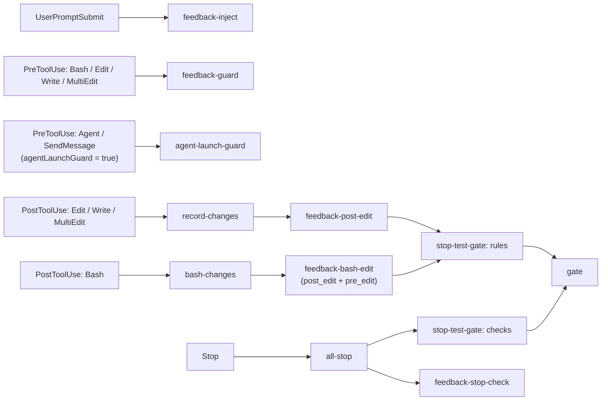

# feedback-gate

[English](README.md)

function hooks で作られた Claude Code プラグインです。次の 3 つを行います。

- フィードバックルール（`~/{.claude,.agents}/feedback/*.md`）を各プロンプトに注入し、ツール呼び出し時と停止時に強制する。
- プロジェクトごとの品質ゲート（lint・テストなど、`{.claude,.agents}/gate.yaml` で定義）を、ファイル編集後と停止時に実行する。
- 確認待ちのときと停止時にデスクトップ通知を出す（macOS）。
- この 2 種類のファイルを書くためのスキル `/feedback-gate:feedback`（フィードバックルールの作成・更新・定期的な棚卸し）と `/feedback-gate:gate`（プロジェクトの言語・タスクランナー・CI に沿った `.claude/gate.yaml` の作成）を同梱する。

## フック

フックは `src/register.ts` で登録され（CI が `hooks/register.js` にバンドルし、それを Claude Code が読み込みます）、`src/` の TypeScript モジュールを呼びます。組織のガードが mod のフックを飛ばす環境のために、同じ検査を `hooks/hooks.json` の command hook（Go 製のバイナリ `feedback-gate`。後述）でも動かします。[組織管理の環境向けの settings hook](#組織管理の環境向けの-settings-hook)を参照。

| イベント | モジュール | 役割 | settings hook |
| --- | --- | --- | --- |
| SessionStart | `src/reset-gate.ts` | `startup` / `clear` のときだけ自セッションのゲート状態を消す。resume / compact では消さない。 | 同じ（下記） |
| UserPromptSubmit | `src/rules-file.ts` + `src/feedback-inject.ts` | ルールファイル（`rulesFile` のファイルがあればそれ、無ければ同梱の `rules/feedback_rules.md`。言語が英語なら `rules/feedback_rules.en.md`）と確定済みフィードバックルール（`count >= 3`）をコンテキストに追加する。 | 同じ（下記） |
| PreToolUse（Bash / Edit / Write / MultiEdit） | `src/feedback-guard.ts` | `pre_bash` / `pre_edit` の enforce を評価し、`count` に応じて deny / ask / warn する。Bash では、書き先と本文がコマンドの文面に書かれている heredoc（`cat > path <<'EOF' ... EOF`、`tee path <<EOF`。[Bash で書いたファイル](#bash-で書いたファイル)）を Write と同じく実行前に `pre_edit` で検査する。 | 同じ（下記） |
| PostToolUse（Write / Edit / MultiEdit） | `src/record-changes.ts` → `src/feedback-post-edit.ts` → `src/stop-test-gate.ts`（`rules`） | 変更ファイルを記録し、`post_edit` の enforce を編集後のファイル全体に対して評価（`count` に応じて block / warn）したあと、`{.claude,.agents}/gate.yaml` の該当ルールを実行する（`src/gate.ts` 経由）。 | 同じ（下記） |
| PreToolUse（Bash） | `src/bash-changes.ts`（`bashStarted`）。`feedback-guard` の前 | コマンドの開始時刻を控える（`bash_started.<session>--<tool_use_id>.json`）。`{.claude,.agents}/gate.yaml` があるプロジェクトでは `.claude/.gate-status/` に、無いプロジェクトでは `~/.claude/feedback/.bash_started/`（`.ask_state` と同じ feedback 側の状態置き場）に置く。後者は `post_edit` / `pre_edit` の enforce を持つ有効な feedback ルールがあるときだけで、`gate.yaml` の無いプロジェクトの作業ツリーには状態ファイルを作らない。 | 同じ（下記） |
| PostToolUse（Bash） | `src/bash-changes.ts` → `src/feedback-bash-edit.ts` → `src/stop-test-gate.ts`（`rules`） | コマンドが実際に書き換えたファイル（cwd の作業ツリーと、`.claude/worktrees/` 配下の worktree のうちコマンドにパス（`worktrees/<name>`）が出てくるものについて。それ以外の worktree は見ないので、別の Claude Code セッションがそこで編集中のファイルをこのコマンドの変更と取り違えない。git の変更・未追跡ファイルと、コマンド中に作られたコミットが触ったファイルのうち、mtime がコマンド開始以降のもの）を拾う。heredoc・`python`・`sed -i` などで書いても、Edit / Write に掛かる検査が抜けないようにするため。*同じ*作業ツリーで動く別セッションとは 2 つの仕組みで分ける（[同じ作業ツリーの複数セッション](#同じ作業ツリーの複数セッション)）: 読むだけのコマンド（`ls`・`cat`・`grep`・`rg`・`find`・`git log` / `git diff` / `git status` など。ファイルへのリダイレクト無し）は最初から見ず、別セッションが gate の状態（別セッションの `changed_files` / `gate_passed` / `gate_failed`）に既に持っているファイルはそのセッションに任せる。各ファイルを、Edit / Write の後と同じく `post_edit` の enforce でファイル全体に対して評価し、実行後に判定できる `pre_edit` の enforce（下記）も評価して、全ファイルの結果を 1 つの block / warn にまとめる。そのあと `{.claude,.agents}/gate.yaml` があるときだけ変更ファイルとして記録し、記録があれば該当ルールを実行する。feedback の検査は `gate.yaml` が無くても動く。git の履歴・作業ツリー操作（rebase / checkout / merge など）は検査も記録もしない。 | 同じ（下記） |
| PreToolUse（Agent / SendMessage）、任意 | `src/agent-launch-guard.ts` | `agentLaunchGuard` が `true` のときだけ有効。サブエージェントへ指示を送る前に、送信本文を見せて確認する。 | 同じ（下記） |
| Notification | `src/notification.ts`（`notify`） | 確認待ちのときにデスクトップ通知（`terminal-notifier` が必要、macOS）。 | 同じ（下記） |
| Stop | `src/all-stop.ts` | ゲートの `checks` フェーズ（直っていない rules の失敗を再実行し、予約された consistency checks を実行）、`src/feedback-stop-check.ts`、`stop` 通知を順に実行する。 | 同じ（下記） |
| SubagentStop | ゲートの `checks` フェーズ、`src/feedback-stop-check.ts`、続けて `src/subagent-report.ts`（`saveSubagentReport`） | サブエージェント向けの同じゲートと `stop_check` ルール。結果は呼び出し元のエージェントへ渡すために控えます（[サブエージェントの結果](#results-of-subagents)）。 | 同じ（下記） |
| PostToolUse（Agent） | `src/subagent-report.ts`（`subagentReport`） | 終わったサブエージェントの gate / `stop_check` の結果を、呼び出し元のエージェントの context に追加します。 | 同じ（下記） |

### 組織管理の環境向けの settings hook

Claude Code を組織が管理している環境（Team / Enterprise ログイン、または managed settings）では、組み込みのガード `cc-plugin-sec-default` が最初に走り、`classic.*` イベントをインストールしたプラグインすべてに対して飛ばします（`/plugin` に「Its hooks on classic.SessionStart, ... do not run here」と出ます）。そこでは上の mod のフックが一つも走りません。`hooks/hooks.json` の `command` hook（settings hook）はガードに飛ばされず、同じ classic イベントを、同じ stdin の JSON と同じ戻り値の規約（exit 2 で block、`permissionDecision`、`decision: block`、`additionalContext`）で受け取ります。そこで `hooks/hooks.json` に、SessionStart・UserPromptSubmit・PreToolUse（`Bash|Edit|Write|MultiEdit|Agent|SendMessage`）・PostToolUse（`Bash|Edit|Write|MultiEdit|Agent|Task`）・Notification・Stop・SubagentStop の command hook を登録しています。上の表の各行は、command hook 経由でも同じ挙動です。

- **動き方。** 各 hook は `bash "${CLAUDE_PLUGIN_ROOT}/scripts/hook.sh" <Event>` で、`scripts/hook.sh` が `feedback-gate claude <Event>` を実行します。これは、このリポジトリの GitHub Releases で配布している Go 製の単一バイナリ（`cmd/feedback-gate`。検査は `internal/hookgate`）です。stdin の classic の JSON を読み、mod のフックと同じ検査を行い、classic の command hook と同じ形で結果を出力します。PostToolUse・Stop・SubagentStop は gate のコマンドが長くなりうるので `timeout` を 600 秒にしています。
- **バイナリの入手先。** `scripts/hook.sh` は次の順に探します。まず `FEEDBACK_GATE_BIN`（実行できるファイルのパス。開発とテスト用で、ダウンロードを避ける手段でもあります）、次に `${FEEDBACK_GATE_CACHE_DIR:-${XDG_CACHE_HOME:-$HOME/.cache}/feedback-gate}/<version>/feedback-gate` です。`<version>` は `.claude-plugin/plugin.json` の `version` です。どちらにも無ければ、`https://github.com/nonchan7720/claude-hook-gate/releases/download/v<version>/feedback-gate_<os>_<arch>.tar.gz`（`os` は `linux` / `darwin`、`arch` は `amd64` / `arm64`）を `checksums.txt` と一緒にダウンロードし、SHA-256（`sha256sum` か `shasum`。どちらも無ければ検証できないので何も入れません）を照合し、展開して、バイナリをキャッシュへ原子的に移します。`FEEDBACK_GATE_RELEASE_BASE_URL` で `https://github.com/nonchan7720/claude-hook-gate/releases/download` の部分を差し替えられます（`file://` のディレクトリも使え、テストはこれを使います。`wget` は `file://` を読めないので `curl` が必要です）。バイナリは常にインストール済みのプラグインのバージョンと一致します。複数のバージョンが同じキャッシュを共有できます（たとえば Claude Code のプラグインと Codex のプラグインが別のバージョンのとき）。バージョンのディレクトリはそのバイナリを使うたびに touch し、新しくインストールしたあとは、30 日より長く使われていない別バージョンのディレクトリだけを削除します（フックが強制終了されて残った、60 分より古いダウンロード用の作業ディレクトリも片付けます）。
- **初回の動作。** インストールや更新のあとの最初のフック（SessionStart）が、そのフックの `timeout` の中でバイナリ（数 MB）をダウンロードします。バージョンごとに 1 回だけです。避けたいときは、`FEEDBACK_GATE_BIN` でビルド済みのバイナリを指定してください。
- **初回は `curl` か `wget` が必要です。** バイナリがまだキャッシュに無く、ダウンロードもできない場合（`curl` も `wget` も無い、`sha256sum` も `shasum` も無い、ネットワークが無い、チェックサムの不一致、未対応の OS や CPU）、command hook は何もしません（exit 0）。標準エラーには `feedback-gate: could not install the feedback-gate v<version> binary (<reason>); the hook did nothing` の 1 行だけを出します。`<reason>` は `no-download-tool`、`no-sha256-tool`、`download-failed`、`checksum-mismatch`、`unsupported-platform`、`bad-version`、`extract-failed`、`cache-unwritable`、`no-cache-dir` のどれかです。その場合に動くのは mod のフックだけなので、ガードに飛ばされる環境では何も動きません。バイナリがキャッシュに入れば、ほかに必要なものはありません。
- **二重に動かさない。** `classic.*` の mod のフックは、走るたびにマーカーファイル `~/{.claude,.agents}/feedback/.classic_seen/<session>` を書きます（`CLAUDE_FEEDBACK_DIR` を尊重。`classic.Notification` では毎回書き直し、24 時間より古いものは掃除されます）。`scripts/hook.sh` はそのセッションのマーカーがあれば exit 0 で黙るので、mod のフックが走る環境では command hook は何もしません。ガードに飛ばされる環境ではマーカーが書かれず、command hook が処理します。（同じイベントの mod のフックと command hook は同時に始まるので、セッションの最初のイベントである SessionStart は両方が走りうる場合があります。リセットは何度走っても同じ結果になり、以降はマーカーがあります。）
- **プラグイン設定。** `language`・`agentLaunchGuard`・`autoCount`・`rulesFile` は、環境変数 `CLAUDE_PLUGIN_OPTION_language`・`CLAUDE_PLUGIN_OPTION_agentLaunchGuard`（`true` / `false`）・`CLAUDE_PLUGIN_OPTION_autoCount`・`CLAUDE_PLUGIN_OPTION_rulesFile` として command hook に渡され、`feedback-gate` が読みます。
- **違い。** 評価中にステータス行に出す表示（`$.ui.status`）は mod の機能で、command hook は出しません。プロンプトの上の帯（実行中の gate コマンド）は mod の `ui.render` が `.claude/.gate-status/running/` の同じファイルから描き、command hook もそのファイルを従来どおり書きます。描き直しは mod が次に描画するときです。

### Bash で書いたファイル

Bash コマンドは、一般には実行前に何が書かれるか分からないので、`pre_edit` を PreToolUse で評価できません。例外は、書き先と本文がコマンドの文面に書かれている heredoc です。`src/bash-heredoc.ts` が PreToolUse でそれらを取り出し、`src/feedback-guard.ts` が各書き先に本文を内容として `pre_edit` の enforce を Write とまったく同じに評価します（`deny` / `ask` はコマンドを止める。同じセッション・同じルール・同じファイルで既に `ask` したものは Edit と同じく `warn` に落とす。理由にはファイルのパスが付く。同じコマンドの別の heredoc で書くテストファイルは `absent_sibling` / `absent_glob` を満たす）。読み取る形は `cat > path <<'EOF' ... EOF`、`cat <<EOF >> path`（`<<-` や、区切り語の引用・`\` エスケープはどれでも可）、`tee [-a] path <<EOF`、`cat <<EOF | tee [-a] path` です。本文は書かれたとおりに扱い（区切り語を引用しない heredoc では bash が `$VAR` を展開するが、検査では展開しない）、相対パスはコマンドの cwd 起点に解決します（先頭の `cd dir &&` は追いません）。実行時にしか分からない書き先（`$OUT`、`$(mktemp)`、`HOME` の無い `~`）、本文を加工するコマンド（`sed ... <<EOF > out`、`cat <<EOF | sort > out`、`python - <<EOF`）、区切り行の無い heredoc はここでは検査しません。コマンドの実行後、この方法で検査した書き先には `pre_edit` を再び掛けず（`post_edit` は掛けます）、それ以外にコマンドが書き換えた各ファイルには `src/feedback-bash-edit.ts` が `pre_edit` を同じ条件で評価します: `path` / `exclude_path`、`absent_sibling` / `absent_glob`（コマンド終了時点でテストファイルがあればよいので、同じコマンドでテストも書けば通る）、そして `when` / `unless` はそのコマンドが書いた内容に対して（git が追跡しているファイルなら `HEAD` との差分の追加行。同じコマンドでコミット済みなら、開始以降のコミットの追加行。追跡外のファイル（新規作成や git の外）なら Write の `content` と同じく全文）。書き込みは済んでいるので、`deny` / `ask` は PostToolUse の `block`（ファイルを直させる）になり、メッセージに「実行後に検知した」旨が付きます。同じセッション・同じルール・同じファイルで既に `ask` したものは、Edit と同じく `warn` に落とします。警告・block にはファイルのパスが付きます。検査の対象は git が列挙できるファイル（追跡中か、未追跡で ignore されていないもの）だけで、git の作業ツリーの外や `.gitignore` されたファイルへの書き込みは検査されません。

### 同じ作業ツリーの複数セッション

<a id="同じ作業ツリーの複数セッション"></a>上の Bash の変更検出は、誰がファイルを書いたかを知らない。git が変更ありと見ているファイルの mtime がコマンド開始以降かどうかしか見ない。同じ作業ツリーで 2 つの Claude Code セッションが動いている（たとえば片方が編集、片方が調査だけ）と、編集セッションの書き込みが調査セッションのコマンドの間に入り、調査セッションはそれを自分の変更として記録し、該当する gate ルールを走らせ、相手の書きかけで落ち、Stop では同じコマンドの相手の実行を待つ（`~/.claude/.gate-status/shared/` の single-flight と serial のロックはセッションを跨ぐ）。これを分けるため、`src/bash-changes.ts`（`isReadOnlyCommand`。`internal/hookgate/bash_changes.go` では `IsReadOnlyCommand`）は読むだけのコマンドでは検出を行わず、別セッションが gate の状態に既に持っているファイルは記録しない。

- **読むだけのコマンド。** コマンドを `|`・`&&`・`||`・`;`・改行・`&`・`$(`・バッククォート・`(`・`{` で区切り、各部分の先頭の語（先頭の `VAR=value` の代入と `command` / `builtin` / `time` / `exec` / `nice` は読み飛ばす）がすべて読むだけのものである必要がある: `ls`・`cat`・`head`・`tail`・`grep`・`rg`・`find`・`wc`・`sort`・`uniq`・`cut`・`tr`・`awk`・`sed`・`diff`・`stat`・`du`・`tree`・`pwd`・`echo`・`printf`・`which`・`env`・`jq`・`cd`・`test` など。`git` は `status`・`log`・`diff`・`show`・`blame`・`ls-files`・`grep`・`rev-parse`・`describe`・`branch`・`tag`・`remote`・`fetch` などの読むサブコマンド。`go` は `env`・`version`・`list`・`doc`。ファイルへのリダイレクト（`>` / `>>`。`2>&1` と `/dev/null` 行きは可）、`find` の `-exec` / `-delete`、`sed` の `-i`、`sort` の `-o`、どこかにある `--output` / `--in-place` / `system(`、それ以外の先頭の語（`xargs`・`tee`・`python`・`bun`・`make`・`sudo` など）があれば書くかもしれないコマンドとして従来どおり検査する。判定は検査する側に倒す: 知らないコマンドは書くものとして扱う。
- **別セッションのファイル。** `gate.yaml` があるとき、他のセッション（自分のセッションでも、そのサブエージェント `<session>--<agent>` でもない `<id>`）の `changed_files.<id>.txt`・`gate_passed.<id>.txt`・`gate_failed.<id>.txt` に載っているファイルは、このコマンドの間に mtime が動いていても記録しない。そのセッションの gate が検査する。これは相手が既に記録したファイルにしか効かず（`run_checks` の無いルールを通ったファイルは状態からすぐ消える）、このセッションの Bash が本当にそのファイルを書き換えた場合も、ここでは検査されず相手の gate だけが検査する。

別セッションも同じ作業ツリーに書いている最中に書くコマンドは、従来どおりこのセッションの変更として扱われる。mtime では 2 つのセッションを区別できないため。2 つのセッションが同時に編集するなら worktree（`.claude/worktrees/<name>`）を分けること。

### サブエージェントの結果

<a id="results-of-subagents"></a>サブエージェントの SubagentStop で走った gate と `stop_check` の結果は、サブエージェント自身（block の reason）かユーザー（`systemMessage`）にしか届きません。呼び出し元のエージェントにはサブエージェントの最後の発言しか見えないため、検証が通ったかを知るには gate のログを読む必要がありました。そこで SubagentStop のたびにその回の結果を、プロジェクトの他の状態ファイルと同じ `.claude/.gate-status/subagent_report.<session>--<agent>.json` に控え（`gate.yaml` が無い PJ では `stop_check` が何か見つけたときだけ）、呼び出し元の `Agent` の PostToolUse で、ツール結果の `agentId` のファイルを context に追加して消します。例:

```
[feedback-gate] サブエージェント code-implementer (a1b2c3) の停止時に実行された hook（gate の検証と feedback の stop_check）の結果です。gate のログを読んだり検証を再実行したりせず、これを使ってください:
[gate] 検証がすべて通りました: lint ✓ / typecheck ✓ / test ✓
```

渡すのは最後の SubagentStop（サブエージェントが実際に止まった回）の結果です: `[gate] 検証がすべて通りました: ...`、`checks` フェーズの要約、または `MAX_ATTEMPTS` 回で打ち切ったときの失敗の内容と、`stop_check` の warn（またはその打ち切り）。成功報告の直後の Stop は gate のコマンドを実行しないので、直前の回の「検証がすべて通りました」を残します。何も実行されず何も見つからなかったときは何も追加しません。バックグラウンドで起動したサブエージェントは PostToolUse の後に終わるため、結果は渡されません。そうして残ったファイルは、他の状態ファイルと同じくセッション開始時の `reset-gate` が消します（`startup` / `clear`、または 24 時間超）。

### エージェント起動ガード（任意）

`src/agent-launch-guard.ts` は、`userConfig` の `agentLaunchGuard` を `true` にしたときだけ有効になります（既定は `false`）。有効にすると、`Agent` と `SendMessage` の PreToolUse で `ask` を返し、送信しようとしている本文を確認理由にそのまま載せるので、サブエージェントに渡る前に内容を確認できます。

- `Agent`: `subagent_type` が `code-implementer` のとき、`prompt` を見せて確認する。
- `SendMessage`: 宛先が `git-operator` 以外のとき、`message` を見せて確認する。

どちらにも該当しなければ何も出力せず、通常のパーミッション判定に委ねます。対象のエージェント種別と許可する宛先の既定は `src/agent-launch-guard.ts` 冒頭の `ASK_AGENT_TYPES` / `ALLOW_RECIPIENTS`（`internal/hookgate/agent_launch_guard.go` の `AskAgentTypes` / `AllowRecipients`）です。mod の hook も command hook（`feedback-gate` バイナリ）も、環境変数 `FEEDBACK_GATE_ASK_AGENT_TYPES`（確認する `subagent_type`）と `FEEDBACK_GATE_ALLOW_RECIPIENTS`（確認なしで送ってよい宛先）で差し替えられます。どちらも `,` または `;` 区切りの一覧で、名前の前後の空白は無視し、未設定や空なら既定のままです（例: `FEEDBACK_GATE_ASK_AGENT_TYPES='code-implementer;worker'`）。

有効化するには、`/plugin` でインストールするときに表示される設定画面で `agentLaunchGuard` をオンにするか、後から `/config` メニューのこのプラグインの `agentLaunchGuard` の行で切り替えます。

### count の自動引き上げ

hook（PreToolUse の `pre_bash` / `pre_edit`、PostToolUse の `post_edit`、Stop / SubagentStop の `stop_check`）が feedback ルールの違反を検出すると、違反ログに記録するのと同じタイミングで、そのルールのファイルの `count` を 1 上げます。同じ違反を繰り返すほど強制力が warn → ask / block → deny と上がり、`count: 1` のまま放置されることがありません。Bash（heredoc・`python`・`sed -i` など）で書いたファイルを PostToolUse(Bash) で検査した結果（`post_edit` と、実行後に判定する `pre_edit`。上の「Bash で書いたファイル」）も、Edit / Write と同じく対象です。

- 書き換えるのは、そのとき実際に使われたルールのファイル（グローバルとプロジェクトに同名があればプロジェクト側）の frontmatter 内の `count: N` 行だけです（数値で書かれた行のみ。`count` 行が無い・数値でないルールは上げません）。同じディレクトリの一時ファイルに書いてから `mv` で置き換えます。
- 抑制の単位は「セッション × ルール名」です。同じセッションでは、同じルールを何度違反しても（enforce が複数一致しても、Stop のブロックが続いても）1 回しか上げません。次のセッションでまた違反すればまた上がります。上げ済みのルール名は `~/.claude/feedback/.count_state/<session_id>.json` に記録します。`session_id` が渡されない呼び出しでは上げません。
- 上限は `5`（`severity` の明示が無いときに deny になる値）で、それ以上は上げません。
- 今回の判定は上げる前の `count` で行い、上げた次の違反から新しい強制力が効きます。上げたときは deny / ask / block の理由（warn なら stderr）に「`count` を N → N+1 に上げた」旨の 1 行を添えるので、モデルにも伝わります。
- 書き込みに失敗しても hook は止めません。

無効にするには、`userConfig` の `autoCount` を `false` にします（既定は `true`。`/plugin` のインストール時の設定画面か、後から `/config` で変更）。

### メッセージの言語

hook が出すもの（コンテキストに注入するフィードバックルール、block / warn の理由、gate の結果、帯とステータス行、デスクトップ通知、`/correct` の報告、同梱のルールファイル）は日本語と英語を選べます。`userConfig` の `language`（`/plugin` のインストール時の設定画面か、後から `/config` で変更）で決めます。

- `auto`（既定）: OS の言語設定に従います。環境変数 `FEEDBACK_GATE_LANG`（このプラグイン専用の上書き。`ja` か `en`）、`LC_ALL`、`LC_MESSAGES`、`LANG` の順に最初に値のあるものを見て、`ja` で始まれば日本語（例: `ja_JP.UTF-8`）、それ以外（`en_US.UTF-8`、`C`、`POSIX` など）は英語です。どれも無ければ英語になります。
- `ja` / `en`: 環境によらず常にその言語。

文面は `locales/ja.yaml` と `locales/en.yaml` にあり（メッセージ 1 つにつき 1 キー。実行時に埋める値は `{{name}}`。両ファイルのキーは一致している必要があり、テストで検査します）、[i18next](https://www.i18next.com/) で引きます。言語の判定は `src/i18n.ts` です。文面を変えたいときは YAML を編集してください。この README の例は日本語の文面です（英語では `[gate] 実行中:` が `[gate] running:`、`[gate] 完了:` が `[gate] done:` などになります）。自分で置いた `rulesFile` と、フィードバックルールの `message` は、どの言語でも書いたとおりに出ます。



## コマンド

### `/correct`

繰り返す間違いを、最も効く層で直すためのコマンドです。feedback ルール（`~/{.claude,.agents}/feedback/*.md` と `<project>/{.claude,.agents}/feedback/*.md`）と違反ログ（`~/.claude/feedback/.violations.jsonl`）を集計し、締め直しの提案を出します。`src/register.ts` が `session.start` で登録し、ロジックは `src/correct.ts` にあります。

```
/correct [--window 30d] [--min 2] [apply]
```

- `--window`: 違反を数える期間。`Nd` または `Nh`（既定 `30d`）。
- `--min`: 提案を出す窓内の最小違反回数（既定 `2`）。
- `apply`: `bump` の提案をルールファイルに書き込みます（下記）。付けなければ何も変更しません。

不明な引数は無視します。提案は次の 5 種類で、この順に並びます。

| 種類 | 条件 | 提案 |
| --- | --- | --- |
| `broken` | ルールファイルが読めない、または `enforce` の要素が不正（[壊れたルール](#broken-rules)を参照）。ルール名はファイル名から `.md` を除いたもの。 | ファイルの修正。理由を添えます。 |
| `bump` | 有効なルールの窓内の違反が `--min` 回以上。 | `count` 1〜2 は 3 へ（確定ルールに昇格）。`count` 3〜4 で窓内の `ask` / `block` が `--min` 回以上なら 5（`deny`）へ。`count` 5 以上は提案しません。 |
| `enforce` | 有効なルールが `count >= 3` なのに `enforce` が無い。hook が検知できず、違反ログにも出ない。 | `enforce` の追加。4 イベント分の雛形を添えます。 |
| `stale` | 有効なルールが `count >= 3` で `enforce` もあるが、違反ログに一度も出ていない。 | `enforce` が効いているか、ルールが古くなっていないかの確認。 |
| `expired` | `expires` / `projects` / `when_exists` のいずれかで無効になっているルールファイル。 | 削除または更新。 |

`apply` が書き換えるのは、`bump` 対象ファイルの frontmatter 内の `count:` 行だけです。変更したファイルの一覧を表示し、それ以外は一切触りません。`enforce`（と `stale` / `expired`）は提案のみで、Claude はそれをユーザーに提示し、ファイルを書き換える前に確認します。

自動引き上げ（`autoCount`）が有効なら、違反したセッションごとに `count` が 1 ずつ上がります。`bump` 提案は窓内の違反回数を根拠に 3 や 5 へ一気に引き上げるもので、`apply` は提案時の `count` がファイルと一致するときだけ書き換えるため、自動引き上げと二重に上がることはありません（提案は常に現在の `count` から出ます）。

## スキル

`skills/` に 2 つのスキルを同梱しています。プラグインと一緒に Claude Code が読み込み、`/feedback-gate:<name>` で呼び出せます（説明文から Claude が自分で使うこともあります）。それぞれ手順を書いた `SKILL.md` と、必要なときに読む参照ファイルからなり、フックの動作はスキルに依存しません。

### `/feedback-gate:feedback`

フィードバックルールのファイル（`~/.claude/feedback/*.md`、`<project>/.claude/feedback/*.md`）を作成・更新・棚卸しします。

```
/feedback-gate:feedback [create|update|review] [トピックまたはルール名]
```

- `create`: フィードバック・指摘・好みを受けたとき。保存してよいか確認し、グローバルかプロジェクトか（または `projects` / `when_exists` / `expires` で絞ったグローバルルールか）を選び、具体的な指摘を抽象的なルールに変換して本文の第 1 段落（フックが注入する部分）に書き、ファイル名を snake_case で付け、`count` を決め（1 は暫定、3 は確定）、フックが検知できるものにだけ `enforce` を付け（イベントの選択、正規表現の検証）、書いたファイルを読み戻して frontmatter を確認します。
- `update`: 同じ指摘の再発（そのセッションでフックが上げていなければ `count` を 1 上げる）、誤検知したルール（削除せず `unless` / `exclude_path` で絞る）、`enforce` の無い確定ルール、文言の修正、適用範囲の変更。
- `review`: 定期的な棚卸し（`skills/feedback/review.md`）。`/correct` を実行し、`.violations.jsonl` からルールごとの違反回数を集計し、全ルールを 1 つの表にして「維持・昇格・修正・絞り込み・統合・範囲変更・廃止（期限切れ、不要になった、`gate.yaml` や linter で代替された）」の提案を付けます。削除と統合は確認してからにします。

書式のリファレンス（`skills/feedback/reference.md`）と、4 つの `enforce` イベントそれぞれの完成例（`skills/feedback/examples.md`）をスキルに同梱しています。スキルが編集するのはルールファイルだけで、フックの状態ファイルには触れません。

### `/feedback-gate:gate`

プロジェクトの `.claude/gate.yaml` を作成・更新します。

```
/feedback-gate:gate [init|update|review]
```

コマンドを推測せず、まずプロジェクトが実際に動かしているものを読みます。マニフェスト（言語とパッケージマネージャ）、タスクランナー（`Makefile`、`justfile`、`Taskfile.yml`、`mise` のタスク、`package.json` の scripts）、CI 設定（GitHub Actions、GitLab CI、CircleCI など）や pre-commit 系のフック、リポジトリの構成（単一パッケージ、ワークスペース、1 ディレクトリ 1 パッケージ）です。それをゲートに写します。ファイル単位の lint・フォーマット検査・型検査とパッケージのテストは `rules` に（ツールがファイルを受け取れるなら `$CLAUDE_GATE_FILES` を渡す）、プロジェクト全体のテストやビルドは `consistency_checks` に置いて `run_checks` から参照し、モノレポには `per_file_dir`、各コマンドに `name`、独立したものは `parallel`、計測した所要時間から `timeout`、全体を見るコマンドには `files: false` を付けます。CI だけで必要なもの（カバレッジのアップロード、デプロイ、サービスやシークレットが要るステップ）は外して報告に列挙します。引き渡す前に、各コマンドを現在のツリーで 1 回ずつ実行し（通常の権限確認を通ります）、スキーマのキー一覧と照合し、`.gitignore` に `.claude/.gate-status/` があることを確かめます。`review` は現在のファイルと CI のずれを編集せずに報告します。フィールドのリファレンス、調査のチェックリスト、ツールチェーン別のレシピ（TypeScript、ワークスペース、Python、Go、Rust、Ruby、JVM、Terraform、シェル、Makefile 駆動）は `skills/gate/` にあります。

## インストール

```
/plugin marketplace add nonchan7720/claude-hook-gate
/plugin install feedback-gate@claude-hook-gate
```

1 行目でこのリポジトリを `claude-hook-gate` マーケットプレイスとして追加し、2 行目でそこから `feedback-gate` プラグインをインストールします。その後スコープを選択します。

### Codex

同じフックを [Codex](https://developers.openai.com/codex) のプラグインとしても [`plugins/codex/`](plugins/codex/README_ja.md) に置いています（カタログは `.agents/plugins/marketplace.json`）。同じフィードバックルールと同じ `gate.yaml`（`.agents/` を先に、次に `.claude/` を見ます）を読むので、両方のツールで使うプロジェクトは同じ検査を受けます。

```
codex plugin marketplace add nonchan7720/claude-hook-gate
```

続けて `/plugins` から `feedback-gate` をインストールし、`/hooks` でそのフックを信頼してください。プラグインのルートはこのリポジトリです（ルートの Codex 用マニフェスト `.codex-plugin/plugin.json` と `plugin.json` が `plugins/codex/hooks/hooks.json` を指します）。そのため `rules/`、`scripts/dogwood/`、`scripts/install-binary.sh`（バイナリのダウンローダ）はコピーせず共有します。検査のロジックは共有で、ホストごとの違い（Codex は `apply_patch` でファイルを編集する、`Notification` の代わりに `PermissionRequest` がある、`ask` が無い）は Go バイナリの `Host` インターフェース（`internal/hookgate/host.go` の `Host`。`feedback-gate claude` / `feedback-gate codex` に対応する実装が `host_claude.go` と `host_codex.go`、パッチの分割は `apply_patch.go`）の後ろに閉じ込めています。TypeScript の mod（`src/register.ts`）は Claude Code 専用で、変わりません。違いと、プラグイン設定の代わりになる環境変数は[プラグインの README](plugins/codex/README_ja.md) を参照。

## 前提

mod のフックにはインストールするものはありません。フックは素の TypeScript で、1 つの JavaScript にバンドルして Claude Code が直接実行します（Python・bash・jq は不要）。

- `curl` または `wget` と `bash`（任意）: settings hook（`hooks/hooks.json`）だけが、プラグインのバージョンごとに 1 回、`feedback-gate` バイナリをダウンロードするために必要とします（`tar` と `sha256sum` / `shasum` も必要です。ハッシュのコマンドが無ければ何も入れません）。無く、かつバイナリがキャッシュに無ければ、settings hook は何もしません。`jq` は必須ではありません（あれば使います）。

- `terminal-notifier`（任意、macOS）: デスクトップ通知にだけ必要です。
- `dogwood`（任意。AWS のツールで、ソースは <https://github.com/dogwood-policy/dogwood>）。`cargo install --git https://github.com/dogwood-policy/dogwood amzn-dogwood-cli` でビルド・インストールできます（crate 名は `amzn-dogwood-cli`、バイナリ名は `dogwood`）。`{.claude,.agents}/gate.yaml` の各コマンドを今実行するか後回しにするかの判定に使います。`DOGWOOD_BIN`、`PATH`、`~/.cargo/bin/dogwood`、`~/.local/share/mise/shims/dogwood` の順に探します。見つからない場合、同梱の既定ポリシーが適用されるコマンドは毎回実行され、`policy:` を指定したコマンドは実行されずに後回しになります。

## 読み込むもの

- プロジェクトの `{.claude,.agents}/gate.yaml`（オプトイン。無ければゲートは何もしません）。書式は `scripts/gate.schema.json`、既定ポリシーは `scripts/dogwood/` にあります。
- `~/{.claude,.agents}/feedback/*.md`: frontmatter（`name`、`description`、`type`、`count`、任意で `enforce`、`expires`、`projects`、`when_exists`）付きのフィードバックルール。`count >= 3` のルールが注入・強制されます。`expires`（`YYYY-MM-DD` ならその日の終わり（UTC）まで有効、または ISO 8601 日時）を過ぎたルールは無効になり、`projects`（プロジェクトディレクトリの絶対パスにマッチする glob の文字列または配列。先頭の `~` は `HOME` に展開）はマッチするプロジェクトに、`when_exists`（プロジェクトルート相対の glob の文字列または配列）は1つでも存在するプロジェクトに適用を絞ります。指定したキーすべてを満たしたときだけ有効で、解釈できない `expires` は無視されます。これらの絞り込みはグローバルとプロジェクトをマージして読む経路にだけかかり、プロジェクト側の同名ルールが無効ならグローバル側も使われません。ディレクトリは `CLAUDE_FEEDBACK_DIR` で変更できます。プロジェクトの `.claude/feedback/*.md` も読み込まれ、グローバルと同じ `name` のルールがあればプロジェクト側が優先されます。
- <a id="broken-rules"></a>壊れたルール: 1つのルールファイルの不備で、他のルールまで無効になることはありません。frontmatter が YAML として読めないファイルは、そのファイルだけを飛ばします。`enforce` がリストでない（`- ` の書き忘れなど）ルールは `enforce` を空として扱い、`enforce` の要素のうち辞書でないもの（`- ` の後が空など）や、`when` / `unless` が使えない正規表現のものは、その要素だけを捨てます（ルールの他の部分は効きます）。評価中に例外になった要素も、その要素だけを飛ばします。正規表現は Python の `re` の書き方で書き、JavaScript で実行します。先頭の `(?i)` / `(?s)` / `(?m)`、`(?P<name>...)`、`(?P=name)`、`\A` / `\Z` / `\z`（テキスト全体の先頭・末尾。`pre_edit` / `post_edit` の複数行モードでも同じ意味）は読み替えます。先頭の `(?x)` と、JavaScript が受け付けない書き方（途中の `x(?i)y` のようなインラインフラグ、`a*+`、`(?#...)`、`(?P>name)` など）は、その要素を不正として扱います。壊れたファイル・要素は、ファイルと理由を `~/.claude/feedback/.errors.jsonl`（`.violations.jsonl` と同じ場所）に 1 回だけ記録し、直すまで毎回のプロンプトで注入するコンテキストの先頭に一覧を出します（「次のルールファイルが読めず無効になっています: ...」）。`/correct` でも `broken` の提案として報告します。feedback の hook が作業を止めないために握りつぶす内部エラーも、同じファイルに記録します。
- ルールファイル: プロンプトごとにコンテキストへ追加されます。既定では同梱の `rules/feedback_rules.md`（日本語）か `rules/feedback_rules.en.md`（英語）を、上記の言語に応じて使います。丸ごと差し替えるには、`rulesFile` のパス（既定は `~/.claude/feedback-gate/feedback_rules.md`。プラグイン設定で変更可、先頭の `~` は展開されます）に自分のファイルを置いてください。そのファイルがあれば言語によらず同梱版の代わりに使われます（両方は入りません）。置き場所に `~/.claude/rules/` は避けてください。Claude Code 自身がこのディレクトリを読み込むため、二重に入ってしまいます。

設定ディレクトリは `.claude` か `.agents` です。上の各ファイルは両方から探し、Claude Code では `.claude` を、Codex では `.agents` を先に見ます。状態ファイル（変更ファイル、試行回数、コマンドのログ）は、両者のうち先に存在する方（どちらも無ければ `.claude/`）の `.gate-status/` 配下に書かれます（`gate.yaml` はその直下のまま）。一方を他方へのシンボリックリンクにしても構いません。両方の経路で見つかるルールは 1 回だけ読み、状態の置き場所も 1 つになります。プロジェクトの `.gitignore` に `.gate-status/` を足してください。旧版が `.claude/` 直下（および `.claude/hooks/logs/`）に残した状態ファイルは、セッション開始時に自動で削除されます。`bash_started.*.json`（`gate.yaml` の無いプロジェクトでは `~/.claude/feedback/.bash_started/` 配下）は実行中の Bash コマンドの開始時刻で、そのコマンドが書き換えたファイルを見分けるために使います。鍵はセッション / エージェント ID ではなく、PreToolUse と PostToolUse の両方に入る呼び出しの `tool_use_id` です（エンジンは `classic.PreToolUse` にエージェント ID を渡さず、`classic.PostToolUse` には `agent_id` が入るので、それらを鍵にするとサブエージェントの中で一致しません）。失敗したコマンド（PostToolUse が来ない）の残骸は、2 時間より古くなれば次の Bash の開始時に消されます。

gate のコマンドが走っている間、プロンプトの上の帯に実行中の内容を 1 項目 1 行で表示します。例:

```
[gate] 実行中:
  typecheck ✓ (0.7s)
  lint ✗ (0.2s)
  test $ bun run test (8s)
```

終わったコマンドも実行開始順のまま、成功は `✓`・失敗は `✗` と固定された所要時間付きで残ります。実行中のコマンドは `名前 $ コマンド` と経過秒（1 秒ごとに更新）を表示します。複数行のコマンドは先頭の 1 行に畳み、長いコマンドは ` ...` で省略して、1 行がおおむね 80 文字に収まります。アンケートが表示されている間は、帯をエンジン側に譲ります。

帯は同じセッションのエージェント（メインとそのサブエージェント）で共有され、実行中のコマンドを 1 つの一覧にまとめて表示します（例: `[gate] 実行中:` の下に `  lint $ bun lint (3s)` と `  test $ bun test 待機中 (2s)` の 2 行）。`待機中` は、別のエージェントで走っている同じ実行の完了を待っているコマンドです（下記）。帯が消えるのは同じセッションの全エージェントの実行が終わったときだけで、同じセッションの他のエージェントがまだ実行中の間はその一覧が残ります。同じプロジェクトを開いている別の Claude Code セッション（別ターミナルなど）の分は表示されず、下記の 1 行サマリもセッションごとに保持されます。

すべて終わると帯は消え、代わりにその回の結果が 1 行でステータス行に残ります。件数だけを出します。例: `[gate] 完了: ✓ 5 / ✗ 1 (81.0s)`（失敗が 0 件なら `✗` は、成功が 0 件なら `✓` は付けません。秒数は並列実行なので合計ではなく、最初の開始から最後の完了までの経過時間です。チェック名は出さないので、どれが落ちたかは Stop hook の出力で確認してください。ステータス行は改行を描けず幅も限られるため、短く保ちます）。次の gate のコマンドが走り始めて帯が出るまで残ります。feedback の検証は従来どおり、走っている間だけステータス行に `[feedback-guard] 評価中: <rule>`、`[feedback-stop-check] 検査中: <rule> (<file>)` と表示し、hook が終わると消えます。

### エージェント間の実行共有

複数のエージェント（メインとサブエージェント）が同時に同じコマンドを実行しようとしたとき、gate は実体を 1 回だけ起動します。「同じ」とは、root・cwd・`cmd`・コマンドに渡す環境変数がすべて一致することで、エージェント識別用の変数（`CLAUDE_AGENT_ID`）と対象ファイル一覧（`CLAUDE_GATE_FILES`）は比較から除きます。対象ファイル一覧はエージェントごとに違いうるので、別に扱います。後から来たエージェントは、同じ条件で進行中の実行のうち、その対象ファイルが自分の対象ファイルをすべて含むもの（自分の一覧が空ならどれでも）があれば、起動し直さず、その完了を待って同じ結果（終了コード・出力・タイムアウト）を受け取ります。受け取った側も自分で実行した場合と同じに扱います（自分の trace とログディレクトリに記録し、同じキーの控えを消化し、フェーズの成否に反映します）。完了済みの結果は再利用せず、重なった実行だけをまとめます。エージェントごとの hook が同じプロセスで動く保証はないため、調停は `.claude/.gate-status/shared/` 配下のファイル（コマンドと対象ファイル一覧の組ごとのロックディレクトリ）で行います。

受け取れる実行が無い場合（対象ファイルが含まれない、環境変数・root・cwd が違うなど）でも、同じコマンドは同時に 1 本しか走らせません。単位は `name`（無ければ `cmd`）で、同じものが別のエージェントで走っている間は起動せず、それが終わるのを待ってから、改めて受け取れる実行を探すか自分で実行します（待っている間は帯に `待機中` と出ます）。`go test ./...` のような重いコマンドをエージェントの数だけ同時に走らせると、CPU の取り合いで全員が何倍も遅くなるためです。異なるコマンドに同じ `name` を付けると、それらも 1 本ずつ走ります。同じリポジトリの別の git worktree で動くエージェントの間でも直列になります（ロックはリポジトリ（共通の git ディレクトリ）ごとの `~/.claude/.gate-status/shared/<project_id>/` に置きます。root・cwd が違うので、結果の受け取りは同じ worktree の中だけです）。ロックの生死はコマンドのプロセスで判定します。ESC などで hook が止められてロックが残っても、コマンドが終わっていれば次のエージェントがすぐに奪い直し、コマンドがまだ走っていればその終了を待ちます。コマンドの `timeout` を過ぎたロックも落ちたものとみなします。`share: false` のコマンドは共有も直列化もせず、常にすぐ自分で実行します。

多くのエージェントがほぼ同時に止まったときの待ちを短くする仕組みが 2 つあります。1 つ目は、同じ `name` の実行を待っているエージェントの対象ファイル一覧をまとめることです。待っている間、各エージェントは自分のキーと対象ファイル一覧を `<serial>.queue/` に置き、次にそのコマンドを起動するエージェントは、自分の対象ファイルと置かれた分の和集合で 1 回だけ走らせます（`CLAUDE_GATE_FILES` に和集合が渡ります）。待っていた側はその 1 回の結果を受け取るので、エージェントの数だけ順に走ることがなくなります。この実行は他のエージェントのファイルも対象に含むので、そのファイルでの失敗は受け取った全員の失敗になります（含む実行を受け取る場合と同じ扱いです）。2 つ目は `gate.yaml` のトップレベルの `max_parallel` で、プロジェクトの全エージェント・全 worktree で同時に走らせる gate コマンドの数の上限です（既定 `2`。`false` で無制限）。コマンドを起動するエージェントは先に共有ディレクトリ配下の `slot.<i>/` を 1 つ取り、空いていなければ空くのを待ちます（共有の結果を受け取るだけなら枠は要りません）。`parallel` ブロックの中や `share: false` のコマンドにも効きます。サブエージェント 10 体がプロジェクト全体のテストを走らせるような場面で、全員が CPU を取り合って何倍も遅くなり（タイムアウトし）続けるのを防ぎ、1 本ずつは単独で走らせたときに近い時間で終わるようにします:

```yaml
max_parallel: 2   # 既定。false で無制限
rules:
  - ...
```

共有（と直列化）したくないコマンドは、`run` 要素に `share: false` を書きます（`{cmd, name, timeout, share, files}`）。

```yaml
run:
  - { cmd: "bun test", name: test, share: false }
```

対象ファイルを使わないコマンド（`go test ./...` のようにファイル一覧に関係なく全体を走らせるもの）は、`files: false` を書くと、共有の判定上の対象ファイルを空として扱い、エージェントごとに対象ファイルが違っても共有されます。`CLAUDE_GATE_FILES` 自体は従来どおりコマンドに渡ります。`share: false` と併記した場合は `share: false` が優先され、共有しません。

```yaml
run:
  - cmd: go test ./...
    name: test
    files: false
```

### 直していない失敗

`rules` フェーズ（PostToolUse）でルールが失敗しても、ターンは止まらず、エラーが Claude へのフィードバックとして返るだけです。ただし失敗したファイルを `.claude/.gate-status/gate_failed.<state>.txt` に控え、次の `checks` フェーズ（Stop / SubagentStop）で、まずそのルールを最新の内容で再実行します。まだ失敗なら、consistency check の失敗と同じく停止をブロックします（成功報告も出しません）。通れば、`rules` フェーズで通ったときと同じ扱いになります。そのため、lint の失敗を直さずにターンを終えることはできません。連続して `MAX_ATTEMPTS`（5）回ブロックしたら諦め、控えを消します（ファイルは変更ファイルの一覧に残るので、次の編集で再び検査されます）。

### 成功報告

checks フェーズ（Stop / SubagentStop）で 1 件以上のコマンドが実際に実行され、すべて成功したとき、gate は Stop を 1 回だけブロックして結果の要約を reason として返します（例: `[gate] 検証がすべて通りました: lint ✓ / typecheck ✓ / test ✓。この結果をユーザーに報告して終了してください。`）。エージェントはこれを受けて、ユーザーが「通ってそう」と伝えなくても完了報告して止まれます。報告でブロックした直後の Stop（`stop_hook_active`）では gate のコマンドを一切実行せず通します。何も実行されなかったとき、`stop_hook_active` が true のとき（失敗ブロックの続き）、`{.claude,.agents}/gate.yaml` のトップレベルに `report_success: false` を書いたとき（既定は有効）は報告しません。失敗時のブロックは従来どおりです。

## セキュリティと権限

レビューする人とインストールする人向けに、このプラグインが何を読み、何を実行し、何を書き、何を判定するかをまとめます。

- **ネットワーク**: プラグイン自身のコードはネットワークに何も送りません（HTTP クライアントを持ちません）。データがマシンの外に出るのは、プラグインが代わりに起動するプログラム（下記）を通したときだけです。つまり、あなたが `{.claude,.agents}/gate.yaml` やフィードバックルールの `check` に書いたコマンド（あなたの権限で動きます）と、macOS のデスクトップ通知です。
- **認証情報**: トークン・鍵・パスワードは読まず、必要ともしません。読む環境変数は `CLAUDE_FEEDBACK_DIR`、`DOGWOOD_BIN`、`FEEDBACK_GATE_LANG`、`HOME`、`LANG`、`LC_ALL`、`LC_MESSAGES`、`PATH`、`TERM_PROGRAM`、`__CFBundleIdentifier` だけです（ファイルやプログラムの場所、メッセージの言語を決めるため）。`gate.yaml` やルールの `check` に書いたコマンドは、あなたが自分で実行するコマンドと同じく、あなたの環境で動きます。
- **会話から読むもの**: Bash / Edit / Write / MultiEdit の呼び出しの入力（コマンド、ファイルパス、新しい内容）。フィードバックルールとの照合と、変更されたファイルの把握に使います。`Agent` / `SendMessage` の prompt と message は、`agentLaunchGuard` が有効なときだけ、確認画面に表示するために読みます。Notification イベントの文面は、デスクトップ通知に載せるために読みます。トランスクリプトは読みません。
- **ディスクから読むもの**: フィードバックルール（`~/{.claude,.agents}/feedback/*.md`、`<project>/{.claude,.agents}/feedback/*.md`）、ルールファイル、`{.claude,.agents}/gate.yaml`、自分の状態ファイル（下記）、Claude が編集したファイル、git から見た作業ツリーの状態。
- **起動するプログラム**:
  - `sh -c` で、`{.claude,.agents}/gate.yaml` のコマンドとフィードバックルールの `check`（どちらもあなたが書くもので、プラグインは同梱しません）。
  - `git`（`rev-parse`、`ls-files`、`diff`、`log`。読み取りのみ）で、リポジトリのルートと、Bash のコマンドが変更したファイルを調べます。
  - `sh`、`mkdir`、`mv`、`rm`、`rmdir`、`kill -0`、`sleep` で、下記ディレクトリにある自分の状態ファイルとロックを扱います。
  - `dogwood`（任意）で、gate のコマンドを今実行するかどうかを決めます。
  - macOS の通知用に `osascript`（前面ウィンドウの名前を読み、今見ているプロジェクトなら通知しないため）と `terminal-notifier`（通知を表示します。クリックすると `open -b <ターミナルアプリ>` か `code -r <プロジェクト>` でウィンドウを前面に出します）。
- **書き込むファイル**:
  - `<project>/{.claude,.agents}/.gate-status/`: gate の状態、コマンドのログ、ロック（プロジェクトに `{.claude,.agents}/gate.yaml` があるときだけ）。
  - `~/{.claude,.agents}/feedback/`: `.violations.jsonl`、`.errors.jsonl`、`.count_state/`、`.ask_state/`、`.bash_started/`、`.classic_seen/`（セッションごとの空のマーカー）。
  - フィードバックルールのファイル（Claude が従う指示）の frontmatter にある `count:` の行。`autoCount` が有効なときにルール違反があると書き換えます（プラグインの設定で無効にできます）。`/correct apply` でも書き換えます。ファイルのそれ以外の部分は変えません。
  - 設定ファイル、`CLAUDE.md`、ビルドや起動のファイル、フックの設定は書きません。
- **権限の判定**（PreToolUse）: 返すのは `deny` か `ask` だけで、`allow` は返しません。呼び出しを厳しくすることはあっても、あなた自身の権限確認を飛ばすことはありません。判定するのは、Bash / Edit / Write / MultiEdit でフィードバックルールに一致したとき（ルールの `count` / `severity` により `deny` か `ask`）と、`agentLaunchGuard` が有効なときの `Agent` / `SendMessage`（全文を見せて `ask`）だけです。それ以外はイベントをそのまま次へ渡します。権限モード、設定、エージェント、Remote Control は変えません。
- **追加するコンテキスト**: UserPromptSubmit で、ルールファイルと確定したフィードバックルール（`count >= 3`）をコンテキストに加えます。PostToolUse・Stop・SubagentStop では、gate の結果とルール違反を Claude に返します（フィードバックかブロックの理由として）。PostToolUse(Agent) では、終わったサブエージェントの結果を呼び出し元のコンテキストに加えます。
- **settings hook**: `hooks/hooks.json` はイベントごとに `command` hook を登録しており、`scripts/hook.sh` を経由して、イベントの JSON を stdin で渡した `feedback-gate claude <Event>`（Go 製のバイナリ）を実行します。mod のフックと同じ検査を行い、同じもの（deny / ask、block、追加する context）を返すので、上の各点はこちらにも当てはまります。セッションの mod のマーカーがあるとき、またはバイナリがキャッシュにも無くダウンロードもできないときは、何もせずに終わります。プラグイン設定は環境変数 `CLAUDE_PLUGIN_OPTION_*` から読みます。
- **コマンド**: セッション開始時に `/correct` を登録し、`command.run` のフックはこのコマンドにだけ応答します。
- **同梱ファイル**: `hooks/register.js` は `src/` から `scripts/build.ts` で作るもので、minify していません。`hooks/vendor/yaml.js` と `hooks/vendor/i18next.js` は npm パッケージの [`yaml`](https://www.npmjs.com/package/yaml) と [`i18next`](https://www.npmjs.com/package/i18next)（`package.json` / `bun.lock` で固定した版）で、ファイルを小さくするためだけに minify しています。検査で報告される getter、`Object.defineProperty`、Promise の判定（`typeof x.then === "function"`）は、この 2 つのライブラリ側のコードです（yaml のドキュメントのクラス、i18next の非同期読み込み）。プラグイン自身のコードは `Proxy`、`eval`、`new Function` を使っていません。

## 開発

[Bun](https://bun.sh) と [Go](https://go.dev)（1.27 以上）が必要です。[mise](https://mise.jdx.dev/) を使うなら、`mise install` で `mise.toml` に書いた道具（bun、node、go、golangci-lint、goreleaser）がすべて入り、`mise run lint|fmt|test|build` が入口になります（下記）。フックのモジュールは Claude Code の中で動き、相対 import と `claude-code` しか解決できないため、`src/` のソース（と `yaml`・`i18next` パッケージ、文字列として取り込む `locales/*.yaml`）を `hooks/register.js` にバンドルします。`yaml` と `i18next` は minify して `hooks/vendor/*.js` に切り出し、バンドルから相対パスで import します。Claude のプラグインディレクトリの「1 ファイル 256 KiB 未満」という制限に余裕を持って収めつつ、プラグイン自身のコードは読める形で残すためです。`hooks/hooks.json` はこのバンドルを指します。ファイルやプロセスへのアクセスはすべてエンジンの `$` API（`$.fs`、`$.process`、`$.env`、`$.session`）を、`src/io.ts` の `Io` インターフェース越しに使います。テストは同じコードを Node の `fs` / `child_process` の上で動かします。

コードは、検査が「それを動かすホスト」に依存しないように層を分けています。中核は classic コマンド hook の JSON を入力に取り、`Outcome` を返します。mod（`src/register.ts`）と command hook の CLI はこれを呼びます。command hook の CLI は Go 製のバイナリ `feedback-gate`（`cmd/feedback-gate`。`feedback-gate claude <Event>` / `feedback-gate codex <Event>` / `feedback-gate version` の 3 つのコマンド）で、検査は `internal/hookgate`（`src/` のモジュール 1 つにつき Go のファイル 1 つ）にあり、`locales/` のメッセージファイルは埋め込んでいます。Claude Code と Codex で違うのは `Host`（環境変数からの `options`、ホストの JSON → 中核のイベントと payload の `normalize`、中核の `Outcome` → ホストの出力の `render`）です。1 回で複数ファイルを編集するツール（Codex の `apply_patch`）はファイルごとの payload に正規化し、中核はそのために `preToolUseEdits` / `postToolUseEdits` を用意しています。

```
mise install         # mise.toml の道具（bun、node、go、golangci-lint、goreleaser）を入れる
bun install          # 開発用の依存を入れる
mise run build       # go build -o bin/feedback-gate ./cmd/feedback-gate
mise run lint        # golangci-lint run ./... && bun run lint
mise run fmt         # golangci-lint fmt ./... && bun run format
mise run test        # go test ./... && bun run test

go test ./...        # Go の単体テスト（internal/hookgate。tests/*.spec.ts を移植したもの）
bun run lint         # Biome（lint とフォーマットの検査）。`bun run format` で自動修正
bun run typecheck    # tsc --noEmit
bun run test         # bun test（tests/*.spec.ts）
bun run build        # src/register.ts を hooks/register.js にバンドル（+ hooks/vendor/*.js）
bun run test:plugin  # ビルドしてから、実エンジンで hooks/register.test.ts を実行
bun run validate:plugin  # claude plugin validate . --strict
```

TypeScript の統合テスト（`tests/cli.spec.ts`、`tests/codex-cli.spec.ts`）は Go のバイナリを子プロセスとして起動し、stdin / stdout / stderr / 終了コードを確かめます。`tests/hook-script.spec.ts` と `tests/codex-hook-script.spec.ts` は、偽のバイナリと偽のリリースのディレクトリ（`FEEDBACK_GATE_RELEASE_BASE_URL=file://...`）で `scripts/hook.sh` を確かめます。バイナリは、`FEEDBACK_GATE_BIN` があればそれを使い（CI が先に 1 度ビルドします）、無ければテストが `go build` で `node_modules/.cache/feedback-gate/feedback-gate` に作ります。

バンドル（`hooks/register.js` と `hooks/vendor/`）は、プルリクエスト上で CI が生成してコミットします。貢献者がコミットする必要はありません（CI が追加するまでリポジトリには入っていません）。「Build bundle」ワークフローが、プルリクエスト（同一リポジトリのブランチ）ごとにバンドルを作り、ファイルの追加または変更があれば `chore: build bundle` コミットをそのブランチへ push します。ローカルで必要なとき（`bun run test:plugin` など）は `bun run build` で作れますが、コミットしないでください。手で編集もしないでください。`scripts/build.ts` は、バンドルが相対パスと `claude-code` 以外を import していたとき、または出力ファイルのどれかが 200 KiB 以上になったときにビルドを失敗させます。また、出力に含まれる見えない文字を `\uXXXX` のエスケープに書き換えます。`classic.PreToolUse` フックの引数名が `hooks/register.js` のほかの場所に出てくるときも失敗させます（プラグインディレクトリは、`next` に渡るイベントを追えない権限フックを受け付けないため）。CI ワークフローは、作ったバンドルに対して `claude plugin validate . --strict` と `claude plugin test .` を実行します。Claude Code の CLI は `devDependencies` の `@anthropic-ai/claude-code` を使います（`bun.lock` で版を固定し、Dependabot が更新します）。

依存には 7 日間のフリーズ期間を設けています。`bunfig.toml` の `minimumReleaseAge` により、`bun install` は公開から 7 日以上経ったバージョンだけを解決します。Dependabot（`.github/dependabot.yml`）も `cooldown` で、npm と GitHub Actions の更新を公開から 7 日経つまで提案しません。Actions はコミット SHA で固定しています。

### リリース

バージョンは [release-please](https://github.com/googleapis/release-please) で管理します。コミットメッセージ（と PR タイトル）は [Conventional Commits](https://www.conventionalcommits.org/ja/)（`feat:`、`fix:`、`refactor:`、`chore:` など）で書いてください。`main` への push ごとに「Release Please」ワークフローがリリース PR を作成・更新し、`package.json`、`.claude-plugin/plugin.json`、`.claude-plugin/marketplace.json`、`.codex-plugin/plugin.json`、`plugin.json` のバージョンを上げて `CHANGELOG.md` を更新します。それをマージするとリリースのタグ（`vX.Y.Z`）が付き、GitHub のリリースが作られます。同じワークフローが続けてそのタグで [GoReleaser](https://goreleaser.com/)（`.goreleaser.yaml`）を実行し、`feedback-gate` を linux / darwin / windows × amd64 / arm64 向けにビルドして、`feedback-gate_<os>_<arch>.tar.gz`（windows は `.zip`）と `checksums.txt` をそのリリースに添付します（リリースノートは release-please が持つので `release.mode: keep-existing` です）。`scripts/hook.sh` はプラグインのバージョンに対応するこれらのファイルをダウンロードするので、リリースにバイナリが付いて初めて、そのバージョンのプラグインが使えます。ただし release-please のジョブがバイナリをビルドするのは、自分が作ったリリースだけです。Go 移植をマージした時点で `plugin.json` が既に持っているバージョン（`v0.9.1`）にはまだバイナリがありません。Go 移植をマージしたあと、「Release Please」ワークフローを 1 度だけ手動で実行してください（Actions → Release Please → Run workflow、`main` から、`tag` に `v0.9.1`。または `gh workflow run release-please.yml -f tag=v0.9.1`）。この `workflow_dispatch` の実行は release-please を飛ばし、実行したブランチの HEAD（古いタグには Go のコードが無いため）をそのタグとして GoReleaser でビルドし、既存のリリースにバイナリを添付します。これで既存のインストールもバイナリを入手できます。同じ方法で、任意のリリースにバイナリを付け直すこともできます。どちらのワークフローも既定の `GITHUB_TOKEN`（PAT は使いません）を使うため、bot が作ったコミットや release-please の PR では CI が自動では起動しません。必須ステータスチェックを設定している場合は、再実行するか空コミットを手で push してください。
