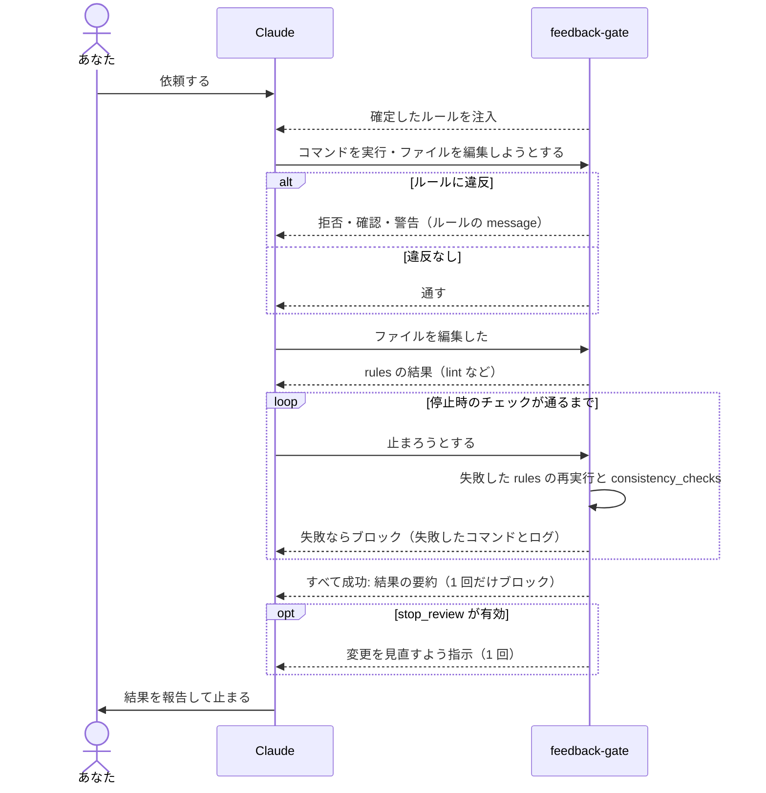

# feedback-gate

[English](README.md)

Claude Code に「同じ指摘を繰り返させない」「検証を通さずに終わらせない」ためのプラグインです。

- **フィードバックルール**: 一度伝えた指摘を Markdown のルールとして残し、毎回のプロンプトに注入します。違反するコマンドや編集は hook が止めます。
- **品質ゲート**: プロジェクトの `gate.yaml` に書いた lint・テストを、ファイルの編集後と停止時に実行します。失敗している間は Claude を止めさせません。
- **停止前の見直し**（任意）: 止まる前に、変更したファイルを Claude 自身に見直させます。そのあいだだけ effort（推論の深さ）を上げます。
- **通知**: 確認待ちと完了をデスクトップ通知で知らせます（macOS）。

Claude Code のほか、[Codex](plugins/codex/README_ja.md) と Claude Cowork でも同じルールと `gate.yaml` で動きます。

## インストール

```
/plugin marketplace add nonchan7720/claude-hook-gate
/plugin install feedback-gate@claude-hook-gate
```

インストールするだけでは何も止めません。ルールと `gate.yaml` を置いたところから効き始めます。

## 使い始める

### 1. プロジェクトに品質ゲートを置く

```
/feedback-gate:gate init
```

プロジェクトの言語・タスクランナー・CI を読んで `.claude/gate.yaml` を作り、各コマンドを 1 回ずつ実行して確かめます。手で書くならこうです。

```yaml
# .claude/gate.yaml
rules:                      # ファイルを編集した直後に走る
  - match: ['src/**/*.ts']
    run:
      - name: lint
        cmd: bun run lint
    run_checks: [verify]    # 停止時に走らせるチェックを予約する

consistency_checks:         # 停止時（Stop / SubagentStop）に走る。失敗すると止まれない
  - name: verify
    run:
      - name: test
        cmd: bun run test

stop_review: true           # 任意: 止まる前に、変更を自分で見直させる
```

状態ファイルが `.claude/.gate-status/` に出来るので、`.gitignore` に足してください。

### 2. 指摘をルールにする

Claude に指摘したあと、こう頼みます。

```
/feedback-gate:feedback create
```

指摘を抽象的なルールに直し、`~/.claude/feedback/`（全プロジェクト）か `<project>/.claude/feedback/`（そのプロジェクトだけ）に保存します。ルールはこういうファイルです。

```
---
name: no_force_push
description: force push をしない。履歴の書き換えはユーザーが明示したときだけ。
type: feedback
count: 3
enforce:
  - event: pre_bash
    when: 'git\s+push\b.*(\s--force\b|\s-f\b)'
    message: 'force push はしない。新しいコミットを積むか、先にユーザーに確認する。'
---

ブランチを force push しない。コミットを積む。
```

`count` が強制力を決めます。違反を検出するたびに自動で 1 上がります（セッションごとに 1 回、最大 5）。

| count | プロンプトへの注入 | コマンド・編集の前 | 編集の後・停止時 |
| --- | --- | --- | --- |
| 1〜2（暫定） | しない | 警告 | 警告 |
| 3〜4（確定） | する | 確認を求める | ブロック |
| 5 以上 | する | 拒否 | ブロック |

`enforce` には、hook に検知させる条件を書きます。

| `event` | 検査するもの |
| --- | --- |
| `pre_bash` | 実行しようとしているコマンド |
| `pre_edit` | 書き込もうとしている内容 |
| `post_edit` | 編集したあとのファイル全体 |
| `stop_check` | 止まるときの変更ファイル |

書式と例は [`skills/feedback/reference.md`](skills/feedback/reference.md) と [`examples.md`](skills/feedback/examples.md) にあります。

## 動きの流れ



## 動いているときに見えるもの

- ゲートのコマンドが走っている間、プロンプトの上に `[gate] 実行中:` の一覧が出ます。終わると `[gate] 完了: ✓ 5 / ✗ 1 (81.0s)` が残ります。
- ゲートが失敗すると、Claude は失敗の内容を受け取って直し続けます（5 回連続で失敗したら打ち切り）。すべて通ると、結果の要約を受け取ってから止まります。
- ルールに違反すると、`count` に応じて警告・確認・拒否になり、理由としてルールの `message` が Claude に返ります。

  ```
  no_force_push (count: 5): force push はしない。新しいコミットを積むか、先にユーザーに確認する。
  ```

- `stop_review` を有効にすると、止まる直前に `[stop-review]` の指示が 1 回出て、Claude が変更を見直してから止まります。

## コマンドとスキル

| 呼び出し | 用途 |
| --- | --- |
| `/feedback-gate:gate [init\|update\|review]` | `gate.yaml` を作る・直す・CI とのずれを調べる |
| `/feedback-gate:feedback [create\|update\|review]` | ルールを作る・直す・棚卸しする |
| `/correct [--window 30d] [--min 2] [apply]` | 違反ログを集計し、`count` の引き上げや `enforce` の追加を提案する |
| `/hook-list` | このプロジェクトで「いつ・何が」動くかをブラウザで一覧する |
| `/feedback-gate:effort-<level>` | そのターンの残りの effort を切り替える（`stop_review` が使う） |

詳細は [コマンドとスキル](docs/ja/commands-and-skills.md)。

## 設定

`/plugin` のインストール時の画面か、後から `/config` で変えられます。

| 設定 | 既定 | 内容 |
| --- | --- | --- |
| `language` | `auto` | メッセージの言語（`ja` / `en`。`auto` は OS の言語） |
| `autoCount` | `true` | 違反を検出したらルールの `count` を 1 上げる |
| `agentLaunchGuard` | `false` | サブエージェントへ指示を送る前に本文を見せて確認する |
| `rulesFile` | `~/.claude/feedback-gate/feedback_rules.md` | 毎回注入する共通ルールファイルを差し替える |

詳細は [設定](docs/ja/settings.md)。

## 動作環境

| 環境 | 必要なもの | 詳細 |
| --- | --- | --- |
| Claude Code | なし | |
| 組織管理の Claude Code（Team / Enterprise） | `bash` と、`curl` か `wget` | [組織管理の環境](docs/ja/managed-environments.md) |
| Claude Cowork | 同上 | [Cowork](docs/ja/install.md#claude-cowork) |
| Codex | 同上 | [Codex プラグインの README](plugins/codex/README_ja.md) |

素の Claude Code 以外では、同じ検査を行う Go 製バイナリ `feedback-gate` を、初回に GitHub のリリースから取得します。そのために上のツールが要ります。

任意で、`terminal-notifier`（macOS の通知）と `dogwood`（ゲートのコマンドを今走らせるかの判定）を使えます（[前提](docs/ja/install.md#前提)）。

## セキュリティと権限

- プラグイン自身はネットワークに何も送りません。外に出るのは、あなたが `gate.yaml` やルールの `check` に書いたコマンドを通したときだけです（組織管理の環境では、バイナリの取得で GitHub に接続します）。
- 権限の判定で返すのは `deny` と `ask` だけで、`allow` は返しません。あなたの権限確認を飛ばすことはありません。
- 書き込むのは `<project>/.claude/.gate-status/`、`~/.claude/feedback/` の状態ファイル、ルールの `count:` の行だけです。
- `gate.yaml` のコマンドはそのまま実行されます。信頼していないリポジトリの `gate.yaml` は、開く前に中身を確かめてください。

何を読み、実行し、書くかの一覧は [セキュリティと権限](docs/ja/security.md) にあります。

## ドキュメント

| ページ | 内容 |
| --- | --- |
| [フック](docs/ja/hooks.md) | イベントごとに何が動くか、Bash で書いたファイルの扱い、ファイル種別スコープのルール、サブエージェントの結果 |
| [gate.yaml のフェーズと挙動](docs/ja/gate.md) | `session_start`、`stop_review`、エージェント間の実行共有、失敗と成功報告 |
| [ルールとファイル](docs/ja/files.md) | ルールと状態ファイルの置き場所、ルールの書式、壊れたルールの扱い、実行中の表示 |
| [コマンドとスキル](docs/ja/commands-and-skills.md) | `/correct`、`/hook-list`、同梱スキル |
| [設定](docs/ja/settings.md) | エージェント起動ガード、`count` の自動引き上げ、言語 |
| [インストール](docs/ja/install.md) | Codex、Claude Cowork、前提 |
| [組織管理の環境](docs/ja/managed-environments.md) | settings hook と `feedback-gate` バイナリ |
| [セキュリティと権限](docs/ja/security.md) | 読むもの・実行するもの・書くもの・判定 |
| [開発](docs/ja/development.md) | ビルド、テスト、リリース |

`gate.yaml` の全項目は [`scripts/gate.schema.json`](scripts/gate.schema.json) と [`skills/gate/reference.md`](skills/gate/reference.md) にあります。

## ライセンス

[MIT](LICENSE)
