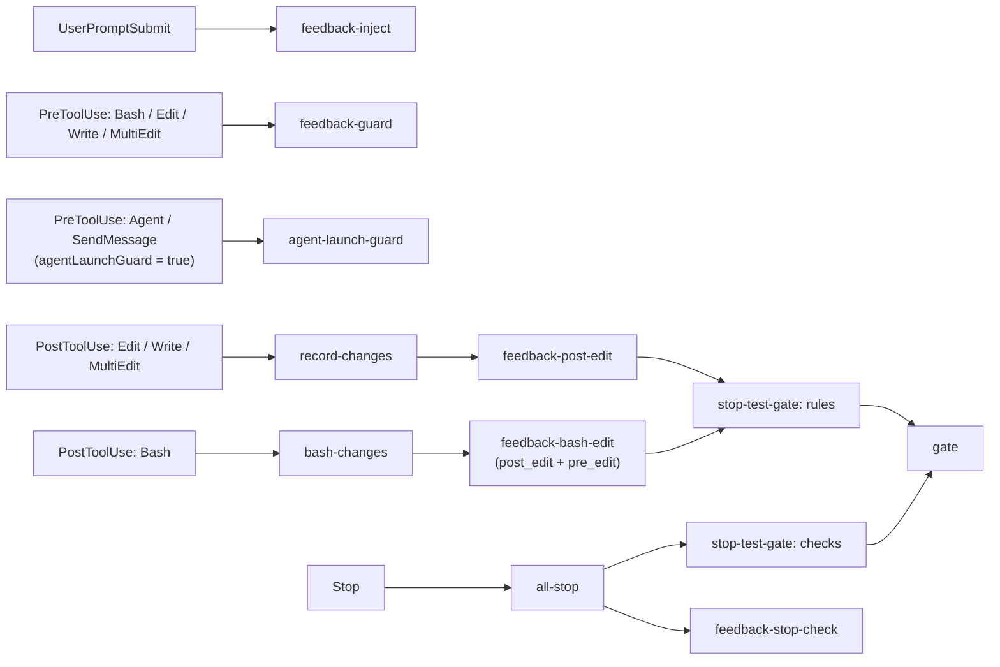

# Hooks

[← README](../README.md) · [日本語](ja/hooks.md)

The hooks are registered in `src/register.ts` (bundled into `hooks/register.js` by CI; that bundle is what Claude Code loads) and call the TypeScript modules under `src/`. The same checks are also run by command hooks in `hooks/hooks.json` (the Go binary `feedback-gate`), for environments where an organization guard skips the mod hooks; see [Settings hooks for managed environments](managed-environments.md#settings-hooks-for-managed-environments).

| Event | Module | Role | Settings hook |
| --- | --- | --- | --- |
| SessionStart | `src/reset-gate.ts`, then `src/gate-session-start.ts` | Clears this session's gate state on `startup` / `clear`; keeps it on resume / compact. Then runs the commands of `session_start` in `gate.yaml` and adds their stdout to the context (see [session_start](gate.md#session_start)). | Same |
| UserPromptSubmit | `src/rules-file.ts` + `src/feedback-inject.ts` | Adds the rules file (your `rulesFile` if it exists, otherwise the bundled `rules/feedback_rules.md`, or `rules/feedback_rules.en.md` when the language is English) and the confirmed feedback rules (`count >= 3`) to the context. Rules with a `files` key are left out here and injected by `feedback-file-inject` instead (see [File-scoped rules](#file-scoped-rules)); this hook also forgets what that injected in the previous turn. | Same |
| PostToolUse (Read) | `src/feedback-file-inject.ts` | Adds the confirmed feedback rules whose `files` globs match the file just read to the context, once per turn per rule. | Same |
| PreToolUse (Bash / Edit / Write / MultiEdit) | `src/feedback-guard.ts` | Evaluates `pre_bash` / `pre_edit` enforce entries; denies, asks or warns by `count`. For Bash, a heredoc whose target and body are plain in the command (`cat > path <<'EOF' ... EOF`, `tee path <<EOF`; see [Files written by Bash](#files-written-by-bash)) is checked by `pre_edit` like a Write, before the command runs. When a Write or heredoc would create a rule file (`*.md`) that does not exist yet directly in a feedback directory (`~/.claude/feedback/`, `.claude/feedback/`), the first attempt per session and file is denied with the list of all existing rules, grouped by directory (in each, those with a similar name / description first, marked ★; rules with no word in common are listed by file name only), so that Claude updates the count and body of a rule for the same feedback instead of adding a duplicate (`src/feedback-new-rule.ts`). The same write is not stopped a second time. | Same |
| PostToolUse (Write / Edit / MultiEdit) | `src/feedback-file-inject.ts`, `src/record-changes.ts`, `src/feedback-post-edit.ts`, then `src/stop-test-gate.ts` (`rules`) | Adds the `files`-scoped rules matching the edited file (if not yet shown this turn), records changed files, evaluates `post_edit` enforce entries against the edited file as a whole (blocks or warns by `count`), then runs the matching rules of `{.claude,.agents}/gate.yaml` (via `src/gate.ts`). | Same |
| PreToolUse (Bash) | `src/bash-changes.ts` (`bashStarted`), before `feedback-guard` | Notes when the command started (`bash_started.<session>--<tool_use_id>.json`): under `.claude/.gate-status/` when the project has `{.claude,.agents}/gate.yaml`; otherwise under `~/.claude/feedback/.bash_started/` (the feedback state directory, next to `.ask_state`), and only when an active feedback rule has a `post_edit` / `pre_edit` enforce entry, so a project without `gate.yaml` gets no state files in its working tree. | Same |
| PostToolUse (Bash) | `src/feedback-file-inject.ts` (heredoc targets), `src/bash-changes.ts`, `src/feedback-bash-edit.ts`, then `src/stop-test-gate.ts` (`rules`) | Adds the `files`-scoped rules matching the targets of plain heredoc writes (see [Files written by Bash](#files-written-by-bash)), then finds the files the command actually rewrote (git-modified or untracked files, and files of commits made during the command, whose mtime is at or after the command start; in the cwd's working tree and in each worktree under `.claude/worktrees/` whose path (`worktrees/<name>`) appears in the command; other worktrees are not looked at, so files another Claude Code session is editing there meanwhile are not taken for this command's changes), so writing with a heredoc, `python`, `sed -i` and the like does not skip the checks that Edit / Write get. Two things keep another session working in the *same* working tree apart (see [Several sessions in one working tree](#several-sessions-in-one-working-tree)): a command that only reads (`ls`, `cat`, `grep`, `rg`, `find`, `git log` / `git diff` / `git status` and the like, with no redirection to a file) is never looked at, and files another session already holds in its gate state (`changed_files` / `gate_passed` / `gate_failed` of another session) are left to that session. Each of those files is checked against the `post_edit` enforce entries as a whole file, like after Edit / Write, and against the `pre_edit` entries that can be judged afterwards (see below); the results of all files are merged into one block / warn. Then, only with `{.claude,.agents}/gate.yaml`, the files are recorded and the matching rules run if something was recorded. The feedback checks work without `gate.yaml`. Git history / working-tree operations (rebase / checkout / merge etc.) are never checked nor recorded. | Same |
| PreToolUse (Agent / SendMessage), opt-in | `src/agent-launch-guard.ts` | Only when `agentLaunchGuard` is `true`: asks before sending instructions to a subagent, showing the full text. | Same |
| Notification | `src/notification.ts` (`notify`) | Desktop notification when Claude waits for you (needs `terminal-notifier`, macOS). | Same |
| Stop | `src/all-stop.ts` | Runs, in order: the gate `checks` phase (reruns the rules that failed and were not fixed, then the reserved consistency checks), `src/feedback-stop-check.ts`, `src/stop-review.ts` (the [stop_review](gate.md#stop_review) of `gate.yaml`, only when enabled), then the `stop` notification. | Same |
| SubagentStop | gate `checks` phase, `src/feedback-stop-check.ts`, `src/stop-review.ts`, then `src/subagent-report.ts` (`saveSubagentReport`) | Same gate, `stop_check` rules and [stop_review](gate.md#stop_review) for subagents. The result is kept so it can be handed to the calling agent (see [Results of subagents](#results-of-subagents)). | Same |
| PostToolUse (Agent) | `src/subagent-report.ts` (`subagentReport`) | Adds the gate / `stop_check` result of the subagent that just finished to the calling agent's context. | Same |

### Files written by Bash

A Bash command cannot in general be checked by `pre_edit` before it runs, since what it will write is unknown until then. The exception is a heredoc whose target and body are plain in the command: `src/bash-heredoc.ts` reads them out on PreToolUse and `src/feedback-guard.ts` evaluates the `pre_edit` entries on each target with the body as the content, exactly like a Write (`deny` / `ask` stop the command; an `ask` already answered for the same rule and file in this session is downgraded to `warn`, as with Edit; the reason names the file; a test file written by a heredoc in the same command satisfies `absent_sibling` / `absent_glob`). The forms it reads are `cat > path <<'EOF' ... EOF`, `cat <<EOF >> path` (`<<-`, and a quoted or `\`-escaped delimiter, are fine), `tee [-a] path <<EOF` and `cat <<EOF | tee [-a] path`; the body is taken as written (an unquoted delimiter lets bash expand `$VAR`, which the check does not do), and a relative path is resolved against the cwd of the command (a leading `cd dir &&` is not followed). A target that is only known at run time (`$OUT`, `$(mktemp)`, `~` without `HOME`), a command that transforms the body (`sed ... <<EOF > out`, `cat <<EOF | sort > out`, `python - <<EOF`) and an unterminated heredoc are not checked here. After the command, the targets checked this way are not checked by `pre_edit` again (`post_edit` still runs on them), and for every other file the command rewrote `src/feedback-bash-edit.ts` evaluates the `pre_edit` entries on each file it rewrote with the same conditions: `path` / `exclude_path`, `absent_sibling` / `absent_glob` (the test file must exist once the command is done, so writing the test in the same command is fine), and `when` / `unless` against the content the command wrote: for a file git tracks, the lines added relative to `HEAD` (or, when the command committed them, the lines added by the commits made since it started); for an untracked file (a new file, or a file outside git), the whole content, as with the `content` of Write. As the file is already written, `deny` / `ask` become a PostToolUse `block` (Claude is told to fix the file), and the message says the rule was only caught after the command. An `ask` already raised for the same rule and file in this session is downgraded to `warn`, as with Edit. Warnings and blocks carry the file path. The checks only see files git can list (tracked, or untracked and not ignored); files written outside a git working tree, or ignored by `.gitignore`, are not checked.

### File-scoped rules

<a id="file-scoped-rules"></a>A feedback rule about one language or kind of file (how to wrap errors in Go, what every SQL migration needs, ...) is only useful while that kind of file is being written, and on every other prompt it just costs context. Give such a rule a `files` key in its frontmatter, a glob or list of globs relative to the project root (`files: ['**/*.go']`; optional `exclude_files`, e.g. `['**/*_test.go']`; same glob rules as `when_exists` and the `enforce` `path`, and in a worktree under `.claude/worktrees/` the path is taken relative to that worktree). Then:

- **It is not injected on UserPromptSubmit.** `src/feedback-inject.ts` skips it, whatever its `count`.
- **It is injected right after the file is touched.** `src/feedback-file-inject.ts` runs on PostToolUse for `Read`, `Edit`, `Write`, `MultiEdit` and, for `Bash`, on the targets of the plain heredoc writes described below. When the file's project-relative path matches `files` (and not `exclude_files`) and the rule has `count >= 3`, the rule (title, `description`, first paragraph of the body, as on UserPromptSubmit) is returned as `additionalContext` under a header naming the file (`# Feedback rules for internal/server/handler.go`). `Read` is the main trigger: Claude almost always reads a file before editing it, so the rule is in the context before the edit is composed; `Edit` / `Write` cover files written without a prior `Read`, from the next edit on (a `pre_edit` enforce entry still stops a violating first write).
- **Once per turn per rule.** The names already shown are kept in `~/.claude/feedback/.inject_state/<session>[--<agent>].json` (the feedback state directory, nothing in the project tree). UserPromptSubmit deletes that file (and the subagents' files of the session), and SessionStart deletes it on `startup`, `clear` and `compact` (not on `resume`), so a rule comes back once in every turn in which such a file is touched, and after a compaction. A subagent has its own state when its hook payload carries an `agent_id`; the mod hooks may run without it, in which case the subagent shares the parent's state for that turn.
- **`enforce` inherits it.** A `pre_edit` / `post_edit` entry of such a rule may omit `path` / `exclude_path`; `files` / `exclude_files` are used instead (an entry that writes its own `path` keeps it).
- `files` only chooses where the rule is injected; it is not one of the activity filters (`expires`, `projects`, `when_exists`), which still apply to it.

Codex has no `Read` tool, so there the rules arrive on `apply_patch` and heredoc targets only.

### Several sessions in one working tree

<a id="several-sessions-in-one-working-tree"></a>The Bash change detection above cannot tell who wrote a file: it only sees that a git-modified file's mtime is at or after the command started. When two Claude Code sessions work in the same working tree (for example one editing, one only investigating), the editing session's writes land inside the investigating session's commands, so that session would record them as its own changes, run the matching gate rules for them, fail on the other session's half-done work, and on Stop wait for the other session's run of the same command (the single-flight and serial locks under `~/.claude/.gate-status/shared/` span sessions). To keep the sessions apart, `src/bash-changes.ts` (`isReadOnlyCommand`; `IsReadOnlyCommand` in `internal/hookgate/bash_changes.go`) skips the detection for a command that can only read, and files another session already holds in its gate state are not recorded.

- **Read-only commands.** The command is split at `|`, `&&`, `||`, `;`, newlines, `&`, `$(`, backticks, `(` and `{`, and every part's first word (after leading `VAR=value` assignments and `command` / `builtin` / `time` / `exec` / `nice`) must be a reading command: `ls`, `cat`, `head`, `tail`, `grep`, `rg`, `find`, `wc`, `sort`, `uniq`, `cut`, `tr`, `awk`, `sed`, `diff`, `stat`, `du`, `tree`, `pwd`, `echo`, `printf`, `which`, `env`, `jq`, `cd`, `test` and the like; `git` with `status`, `log`, `diff`, `show`, `blame`, `ls-files`, `grep`, `rev-parse`, `describe`, `branch`, `tag`, `remote`, `fetch` and other reading subcommands; `go` with `env`, `version`, `list`, `doc`. A redirection to a file (`>` or `>>`; `2>&1` and `/dev/null` are fine), `find` with `-exec` / `-delete`, `sed` with `-i`, `sort` with `-o`, `--output`, `--in-place` or `system(` anywhere, or any other first word (`xargs`, `tee`, `python`, `bun`, `make`, `sudo`, ...) makes the command a possible writer, which is checked as before. The judgement errs on the side of checking: an unknown command is treated as a writer.
- **Files of another session.** With `gate.yaml`, the files listed in `changed_files.<id>.txt`, `gate_passed.<id>.txt` and `gate_failed.<id>.txt` of any other session (an `<id>` that is neither this session nor one of its subagents, `<session>--<agent>`) are not recorded for this command even when their mtime moved during it; that session's gate checks them. This only covers files the other session has already recorded (a file whose gate rule passed without `run_checks` leaves the state right away), and it means a Bash command of this session that really rewrites such a file is not checked here, only by the other session's gate.

A command that writes while another session also writes to the same working tree is still attributed to this session; the two sessions cannot be told apart by mtime. Use separate worktrees (`.claude/worktrees/<name>`) when two sessions edit at the same time.

### Results of subagents

<a id="results-of-subagents"></a>The gate and `stop_check` results of a subagent's SubagentStop only reach the subagent itself (a block reason) or you (a `systemMessage`); the calling agent sees only the subagent's final message, and had to read the gate logs to know whether the checks passed. So on every SubagentStop the result of that round is kept in `.claude/.gate-status/subagent_report.<session>--<agent>.json` in the project, next to the other state files (without `gate.yaml`, only when `stop_check` found something), and on the calling agent's PostToolUse for `Agent` the file of the `agentId` in the tool result is added to its context and removed, e.g.

```
[feedback-gate] Results of the hooks run when subagent code-implementer (a1b2c3) stopped (gate checks and feedback stop_check). Use these instead of reading the gate logs or re-running the checks:
[gate] All checks passed: lint ✓ / typecheck ✓ / test ✓
```

What is handed over is the result of the last SubagentStop (the one that let the subagent stop): `[gate] All checks passed: ...`, the `checks` phase summary, or the give-up message with the failures after `MAX_ATTEMPTS`; and the `stop_check` warnings (or its give-up). The stop right after a success report runs no gate command, so it keeps the `All checks passed` of the round before. When nothing ran and nothing was found, nothing is added. A subagent started in the background finishes after its PostToolUse, so its result is not handed over; like the other state files, such files are removed by `reset-gate` at session start (`startup` / `clear`, or after 24 hours).

## Flow


