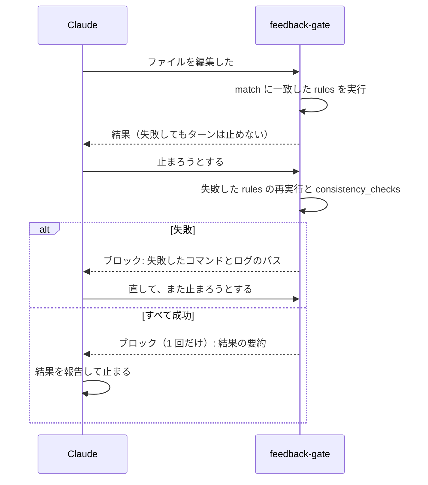
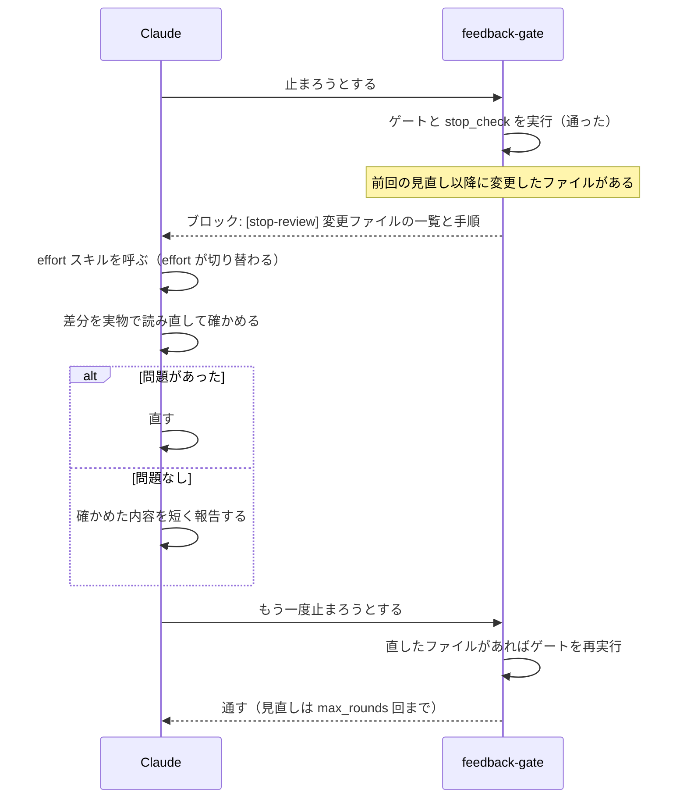

# gate.yaml のフェーズと挙動

[← README](../../README_ja.md) · [English](../gate.md)

`gate.yaml` の各フェーズが、いつ動いて、失敗するとどうなるかの説明です。全項目の一覧は [`skills/gate/reference.md`](../../skills/gate/reference.md) と [`scripts/gate.schema.json`](../../scripts/gate.schema.json) にあります。

| キー | 動くとき | 失敗すると |
| --- | --- | --- |
| `rules` | ファイルの編集直後。`match` に一致したルールをすべて実行 | ターンは止めない。停止時に再実行し、まだ失敗なら止まれない |
| `consistency_checks` | 停止時。一致したルールが `run_checks` で名前を挙げたものだけ | 直すまで止まれない（5 回連続で打ち切り） |
| `session_start` | セッション開始時 | セッションは止めない |
| `stop_review` | 停止時、上のチェックが通ったあと | 失敗はない（コマンドを実行せず、見直しを 1 回求めるだけ） |



コマンドには、対象ファイルが環境変数 `CLAUDE_GATE_FILES` で渡ります（例: `rubocop $CLAUDE_GATE_FILES`）。既定のタイムアウトは 300 秒です。

## 失敗したとき

- **編集直後（`rules`）。** 結果は Claude へのフィードバックとして返るだけで、ターンは止まりません。失敗したファイルは控えられ、停止時にそのルールを最新の内容で再実行します。まだ失敗なら停止をブロックします。lint の失敗を直さずに終えることはできません。
- **停止時。** 失敗したコマンドとログのパスを理由として返し、Claude に直させます。5 回連続でブロックしたら打ち切ります。
- **出力はログに。** フィードバックにはコマンドの出力を載せず、`[gate] fail: ...` の 1 行とログのパス（`.claude/.gate-status/logs/...`）だけを返します。会話を圧迫しないためです。

## 成功報告

停止時にコマンドが 1 件以上実行され、すべて成功すると、停止を 1 回だけブロックして結果の要約を返します。

```
[gate] 検証がすべて通りました: lint ✓ / typecheck ✓ / test ✓。この結果をユーザーに報告して終了してください。
```

Claude はこれを受けて完了を報告して止まります。止めたいときは `gate.yaml` のトップレベルに `report_success: false` を書きます。

## session_start

セッション開始時にコマンドを走らせ、その標準出力をコンテキストに足します（コードグラフの要約を渡す、など）。メインのセッションだけが対象です。

```yaml
session_start:
  - name: depgraph
    cmd: "command -v depgraph >/dev/null || exit 0; depgraph hook session-start --format text"
    timeout: 10                             # 秒。既定 10、上限 600
    on: [startup, resume, clear, compact]   # 省略時はすべて
    background: false                       # true なら起動するだけで待たない
```

- コマンドは並列に走り、exit 0 で終わったものの出力が宣言順に `[gate] session_start: <name>` の見出しつきで足されます。合計の上限は 8 KiB です。
- 失敗やタイムアウトでセッションは止まりません。終了コードとログのパスを 1 回だけ知らせます。
- `background: true` の出力はログにだけ残り、コンテキストには入りません。
- コマンドには `CLAUDE_PROJECT_DIR`、`CLAUDE_SESSION_ID`、`CLAUDE_SESSION_SOURCE` が渡ります。

## stop_review

止まる直前に、変更したファイルを Claude 自身に見直させます。既定は無効です。



ファイルを変更していないターン（質問に答えただけなど）では何もしません。

```yaml
stop_review: true          # すべて既定値で有効
# または
stop_review:
  effort: xhigh            # low / medium / high / xhigh / max。false で effort は変えない
  match: ['src/**', '**/*.go']   # 対象の変更ファイル（省略時はすべて）
  max_rounds: 1            # 見直し中の修正を続けて見直す回数（最大 5）
  subagents: true          # サブエージェントの停止時にも行う
  prompt: |                # プロジェクト固有の確認事項（2000 文字まで）
    マイグレーションを足したら down も確認する。
```

- **見直しの手順。** Claude に返す手順は次の 3 つです。
  1. 変更ファイルの差分を、記憶ではなく実物で読み直す。
  2. 依頼を満たしているか、ロジック、テストやドキュメントの更新漏れ、不要な変更、実際に動かしたかを確かめる。
  3. 問題があれば直す。無ければ、確かめた内容を短く報告して止まる。
- **effort の切り替え。** hook は effort を直接変えられないので、手順の最初で同梱スキル [`effort-<level>`](commands-and-skills.md#feedback-gateeffort-level) を Claude に呼ばせます。効くのはそのターンの残りだけです。Claude がスキルを呼ばなかったとき、スキルの `effort` を扱わない環境（Codex など）では、effort は変わらず見直しだけが行われます。
- **繰り返さない。** 見直し中の修正を続けて見直すのは `max_rounds` 回までです。既定の 1 では、見直しは 1 ターンに 1 回です。
- **信頼できないリポジトリへの備え。** `max_rounds` は 5、`prompt` は 2000 文字で打ち切ります。`prompt` は `gate.yaml` 由来と分かる見出しをつけて出します。

## エージェント間の実行共有

メインとサブエージェントが同時に同じコマンドを走らせようとしたとき、重いコマンドが人数分走らないようにします。

| 状況 | 動き |
| --- | --- |
| 同じコマンド（同じ場所・同じ環境）が実行中で、その対象ファイルが自分の分を含む | 起動せず、その結果を受け取る |
| 同じ `name` のコマンドが実行中だが、結果は受け取れない | 終わるのを待ってから実行する（表示は `待機中`） |
| 複数のエージェントが同じ `name` を待っている | 対象ファイルをまとめて 1 回だけ実行し、全員がその結果を受け取る |

- 同時に走るゲートのコマンド数は、プロジェクト全体で `max_parallel`（既定 2）までです。同じリポジトリの別の worktree も含みます。
- まとめて実行した場合、他のエージェントのファイルでの失敗も、受け取った全員の失敗になります。
- 完了済みの結果は使い回しません。まとめるのは重なった実行だけです。

```yaml
max_parallel: 2            # false で無制限

rules:
  - match: ['**/*.go']
    run:
      - { cmd: "go test ./...", name: test, files: false }
      - { cmd: "bun test", name: unit, share: false }
```

- `files: false`: ファイル一覧に関係なく全体を走らせるコマンドに付けます。対象ファイルが違っても共有します。
- `share: false`: 共有も待ち合わせもせず、常にすぐ自分で実行します。
