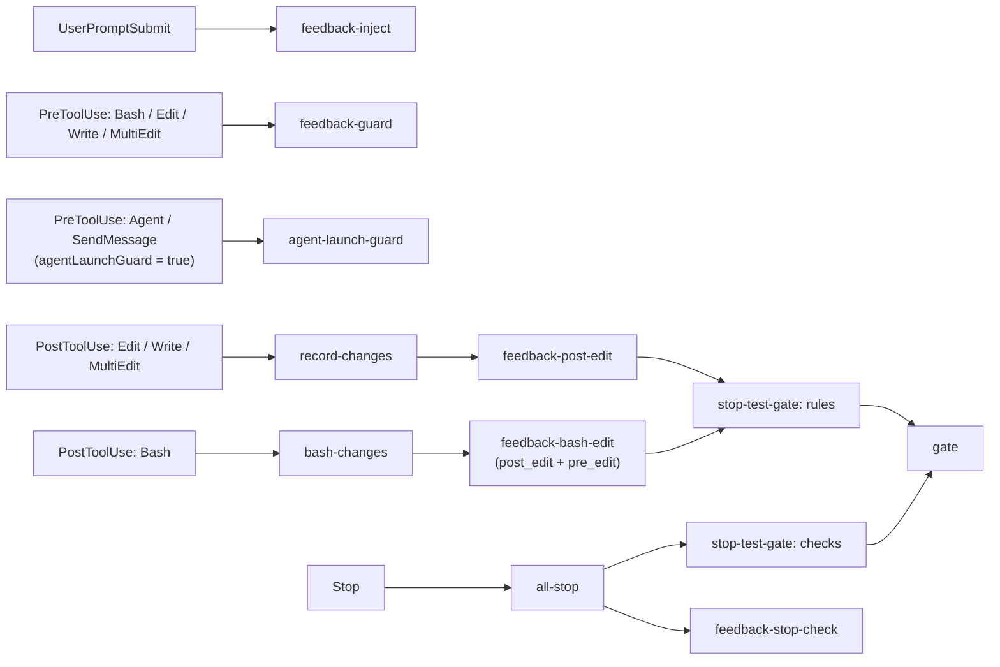

# フック

[← README](../../README_ja.md) · [English](../hooks.md)

フックは `src/register.ts` で登録され（CI が `hooks/register.js` にバンドルし、それを Claude Code が読み込みます）、`src/` の TypeScript モジュールを呼びます。組織のガードが mod のフックを飛ばす環境のために、同じ検査を `hooks/hooks.json` の command hook（Go 製のバイナリ `feedback-gate`）でも動かします。[組織管理の環境向けの settings hook](managed-environments.md#組織管理の環境向けの-settings-hook)を参照。

| イベント | モジュール | 役割 | settings hook |
| --- | --- | --- | --- |
| SessionStart | `src/reset-gate.ts`、続けて `src/gate-session-start.ts` | `startup` / `clear` のときだけ自セッションのゲート状態を消す。resume / compact では消さない。そのあと `gate.yaml` の `session_start` のコマンドを走らせ、stdout を context に足す（[session_start](gate.md#session_start) を参照）。 | 同じ |
| UserPromptSubmit | `src/rules-file.ts` + `src/feedback-inject.ts` | ルールファイル（`rulesFile` のファイルがあればそれ、無ければ同梱の `rules/feedback_rules.md`。言語が英語なら `rules/feedback_rules.en.md`）と確定済みフィードバックルール（`count >= 3`）をコンテキストに追加する。`files` キーを持つルールはここでは出さず、代わりに `feedback-file-inject` が注入する（[ファイル種別スコープのルール](#file-scoped-rules)）。前のターンにそこで注入した記録もここで忘れる。 | 同じ |
| PostToolUse（Read） | `src/feedback-file-inject.ts` | 今読んだファイルに `files` の glob がマッチする確定フィードバックルールを、ターンごと・ルールごとに 1 回だけコンテキストに追加する。 | 同じ |
| PreToolUse（Bash / Edit / Write / MultiEdit） | `src/feedback-guard.ts` | `pre_bash` / `pre_edit` の enforce を評価し、`count` に応じて deny / ask / warn する。Bash では、書き先と本文がコマンドの文面に書かれている heredoc（`cat > path <<'EOF' ... EOF`、`tee path <<EOF`。[Bash で書いたファイル](#bash-で書いたファイル)）を Write と同じく実行前に `pre_edit` で検査する。Write / heredoc で feedback のディレクトリ（`~/.claude/feedback/`・`.claude/feedback/`）の直下にまだ無いルールファイル（`*.md`）を作ろうとしたときは、セッション・ファイルごとに最初の 1 回だけ deny して既存ルール全件の一覧（ディレクトリごと。各ディレクトリの中は name / description が似ているものを ★ 付きで先頭に。語が 1 つも重ならないものはファイル名だけ）を返し、同じ指摘のルールがあれば新しいファイルを作らずに count と本文を更新させる（`src/feedback-new-rule.ts`）。同じ書き込みの 2 回目は止めない。 | 同じ |
| PostToolUse（Write / Edit / MultiEdit） | `src/feedback-file-inject.ts` → `src/record-changes.ts` → `src/feedback-post-edit.ts` → `src/stop-test-gate.ts`（`rules`） | 編集したファイルにマッチする `files` 付きルールを（このターンにまだ出していなければ）追加し、変更ファイルを記録し、`post_edit` の enforce を編集後のファイル全体に対して評価（`count` に応じて block / warn）したあと、`{.claude,.agents}/gate.yaml` の該当ルールを実行する（`src/gate.ts` 経由）。 | 同じ |
| PreToolUse（Bash） | `src/bash-changes.ts`（`bashStarted`）。`feedback-guard` の前 | コマンドの開始時刻を控える（`bash_started.<session>--<tool_use_id>.json`）。`{.claude,.agents}/gate.yaml` があるプロジェクトでは `.claude/.gate-status/` に、無いプロジェクトでは `~/.claude/feedback/.bash_started/`（`.ask_state` と同じ feedback 側の状態置き場）に置く。後者は `post_edit` / `pre_edit` の enforce を持つ有効な feedback ルールがあるときだけで、`gate.yaml` の無いプロジェクトの作業ツリーには状態ファイルを作らない。 | 同じ |
| PostToolUse（Bash） | `src/feedback-file-inject.ts`（heredoc の書き先）→ `src/bash-changes.ts` → `src/feedback-bash-edit.ts` → `src/stop-test-gate.ts`（`rules`） | 文面から分かる heredoc の書き先（[Bash で書いたファイル](#bash-で書いたファイル)）にマッチする `files` 付きルールを追加してから、コマンドが実際に書き換えたファイル（cwd の作業ツリーと、`.claude/worktrees/` 配下の worktree のうちコマンドにパス（`worktrees/<name>`）が出てくるものについて。それ以外の worktree は見ないので、別の Claude Code セッションがそこで編集中のファイルをこのコマンドの変更と取り違えない。git の変更・未追跡ファイルと、コマンド中に作られたコミットが触ったファイルのうち、mtime がコマンド開始以降のもの）を拾う。heredoc・`python`・`sed -i` などで書いても、Edit / Write に掛かる検査が抜けないようにするため。*同じ*作業ツリーで動く別セッションとは 2 つの仕組みで分ける（[同じ作業ツリーの複数セッション](#同じ作業ツリーの複数セッション)）: 読むだけのコマンド（`ls`・`cat`・`grep`・`rg`・`find`・`git log` / `git diff` / `git status` など。ファイルへのリダイレクト無し）は最初から見ず、別セッションが gate の状態（別セッションの `changed_files` / `gate_passed` / `gate_failed`）に既に持っているファイルはそのセッションに任せる。各ファイルを、Edit / Write の後と同じく `post_edit` の enforce でファイル全体に対して評価し、実行後に判定できる `pre_edit` の enforce（下記）も評価して、全ファイルの結果を 1 つの block / warn にまとめる。そのあと `{.claude,.agents}/gate.yaml` があるときだけ変更ファイルとして記録し、記録があれば該当ルールを実行する。feedback の検査は `gate.yaml` が無くても動く。git の履歴・作業ツリー操作（rebase / checkout / merge など）は検査も記録もしない。 | 同じ |
| PreToolUse（Agent / SendMessage）、任意 | `src/agent-launch-guard.ts` | `agentLaunchGuard` が `true` のときだけ有効。サブエージェントへ指示を送る前に、送信本文を見せて確認する。 | 同じ |
| Notification | `src/notification.ts`（`notify`） | 確認待ちのときにデスクトップ通知（`terminal-notifier` が必要、macOS）。 | 同じ |
| Stop | `src/all-stop.ts` | ゲートの `checks` フェーズ（直っていない rules の失敗を再実行し、予約された consistency checks を実行）、`src/feedback-stop-check.ts`、`src/stop-review.ts`（`gate.yaml` の [stop_review](gate.md#stop_review)。有効なときだけ）、`stop` 通知を順に実行する。 | 同じ |
| SubagentStop | ゲートの `checks` フェーズ、`src/feedback-stop-check.ts`、`src/stop-review.ts`、続けて `src/subagent-report.ts`（`saveSubagentReport`） | サブエージェント向けの同じゲートと `stop_check` ルール、[stop_review](gate.md#stop_review)。結果は呼び出し元のエージェントへ渡すために控えます（[サブエージェントの結果](#results-of-subagents)）。 | 同じ |
| PostToolUse（Agent） | `src/subagent-report.ts`（`subagentReport`） | 終わったサブエージェントの gate / `stop_check` の結果を、呼び出し元のエージェントの context に追加します。 | 同じ |

### Bash で書いたファイル

Bash コマンドは、一般には実行前に何が書かれるか分からないので、`pre_edit` を PreToolUse で評価できません。例外は、書き先と本文がコマンドの文面に書かれている heredoc です。`src/bash-heredoc.ts` が PreToolUse でそれらを取り出し、`src/feedback-guard.ts` が各書き先に本文を内容として `pre_edit` の enforce を Write とまったく同じに評価します（`deny` / `ask` はコマンドを止める。同じセッション・同じルール・同じファイルで既に `ask` したものは Edit と同じく `warn` に落とす。理由にはファイルのパスが付く。同じコマンドの別の heredoc で書くテストファイルは `absent_sibling` / `absent_glob` を満たす）。読み取る形は `cat > path <<'EOF' ... EOF`、`cat <<EOF >> path`（`<<-` や、区切り語の引用・`\` エスケープはどれでも可）、`tee [-a] path <<EOF`、`cat <<EOF | tee [-a] path` です。本文は書かれたとおりに扱い（区切り語を引用しない heredoc では bash が `$VAR` を展開するが、検査では展開しない）、相対パスはコマンドの cwd 起点に解決します（先頭の `cd dir &&` は追いません）。実行時にしか分からない書き先（`$OUT`、`$(mktemp)`、`HOME` の無い `~`）、本文を加工するコマンド（`sed ... <<EOF > out`、`cat <<EOF | sort > out`、`python - <<EOF`）、区切り行の無い heredoc はここでは検査しません。コマンドの実行後、この方法で検査した書き先には `pre_edit` を再び掛けず（`post_edit` は掛けます）、それ以外にコマンドが書き換えた各ファイルには `src/feedback-bash-edit.ts` が `pre_edit` を同じ条件で評価します: `path` / `exclude_path`、`absent_sibling` / `absent_glob`（コマンド終了時点でテストファイルがあればよいので、同じコマンドでテストも書けば通る）、そして `when` / `unless` はそのコマンドが書いた内容に対して（git が追跡しているファイルなら `HEAD` との差分の追加行。同じコマンドでコミット済みなら、開始以降のコミットの追加行。追跡外のファイル（新規作成や git の外）なら Write の `content` と同じく全文）。書き込みは済んでいるので、`deny` / `ask` は PostToolUse の `block`（ファイルを直させる）になり、メッセージに「実行後に検知した」旨が付きます。同じセッション・同じルール・同じファイルで既に `ask` したものは、Edit と同じく `warn` に落とします。警告・block にはファイルのパスが付きます。検査の対象は git が列挙できるファイル（追跡中か、未追跡で ignore されていないもの）だけで、git の作業ツリーの外や `.gitignore` されたファイルへの書き込みは検査されません。

### ファイル種別スコープのルール

<a id="file-scoped-rules"></a>特定の言語やファイル種別についてのフィードバックルール（Go でのエラーの包み方、SQL マイグレーションに必ず要るもの、など）は、その種類のファイルを書いている間だけ役に立ち、それ以外のプロンプトではコンテキストを消費するだけです。そういうルールには frontmatter に `files` キー（プロジェクトルート相対の glob の文字列または配列。`files: ['**/*.go']`。任意で `exclude_files`、例 `['**/*_test.go']`。glob の意味は `when_exists` や `enforce` の `path` と同じで、`.claude/worktrees/` 配下の worktree ではその worktree 相対で判定）を書きます。すると:

- **UserPromptSubmit では注入されません。** `count` に関わらず `src/feedback-inject.ts` が飛ばします。
- **ファイルに触れた直後に注入されます。** `src/feedback-file-inject.ts` が `Read`・`Edit`・`Write`・`MultiEdit` の PostToolUse と、`Bash` では後述の素の heredoc の書き先に対して走ります。ファイルのプロジェクト相対パスが `files` にマッチし（`exclude_files` にはマッチせず）、ルールの `count >= 3` なら、そのルール（タイトル・`description`・本文の第 1 段落。UserPromptSubmit と同じ形）を、ファイル名を含むヘッダ（`# internal/server/handler.go に適用されるフィードバックルール`）付きの `additionalContext` として返します。本命は `Read` です。Claude はほぼ必ず編集の前にファイルを読むので、編集内容を考える前にルールがコンテキストにあります。`Edit` / `Write` は Read を挟まずに書いたときの保険で、次の編集から効きます（違反する最初の書き込み自体は `pre_edit` の enforce が止めます）。
- **ターンごと・ルールごとに 1 回。** 出したルール名は `~/.claude/feedback/.inject_state/<session>[--<agent>].json`（feedback の状態置き場。プロジェクトのツリーには何も置かない）に控えます。UserPromptSubmit がそのファイル（とそのセッションのサブエージェント分）を消し、SessionStart は `startup` / `clear` / `compact` で消します（`resume` では消さない）。そのため、そういうファイルに触れたターンごとに 1 回、compaction の後にもまた届きます。サブエージェントは hook の payload に `agent_id` があれば自分の状態を持ちます。mod hook は `agent_id` 無しで動くことがあり、その場合そのターンは親の状態を共有します。
- **`enforce` に引き継がれます。** そのルールの `pre_edit` / `post_edit` の要素は `path` / `exclude_path` を省略でき、`files` / `exclude_files` が使われます（自分で `path` を書いた要素はそのまま）。
- `files` は注入先を決めるだけで、有効/無効のフィルタ（`expires` / `projects` / `when_exists`）ではありません。それらは `files` 付きのルールにも同じくかかります。

Codex には `Read` ツールが無いので、そこでは `apply_patch` と heredoc の書き先でだけ届きます。

### 同じ作業ツリーの複数セッション

<a id="同じ作業ツリーの複数セッション"></a>上の Bash の変更検出は、誰がファイルを書いたかを知らない。git が変更ありと見ているファイルの mtime がコマンド開始以降かどうかしか見ない。同じ作業ツリーで 2 つの Claude Code セッションが動いている（たとえば片方が編集、片方が調査だけ）と、編集セッションの書き込みが調査セッションのコマンドの間に入り、調査セッションはそれを自分の変更として記録し、該当する gate ルールを走らせ、相手の書きかけで落ち、Stop では同じコマンドの相手の実行を待つ（`~/.claude/.gate-status/shared/` の single-flight と serial のロックはセッションを跨ぐ）。これを分けるため、`src/bash-changes.ts`（`isReadOnlyCommand`。`internal/hookgate/bash_changes.go` では `IsReadOnlyCommand`）は読むだけのコマンドでは検出を行わず、別セッションが gate の状態に既に持っているファイルは記録しない。

- **読むだけのコマンド。** コマンドを `|`・`&&`・`||`・`;`・改行・`&`・`$(`・バッククォート・`(`・`{` で区切り、各部分の先頭の語（先頭の `VAR=value` の代入と `command` / `builtin` / `time` / `exec` / `nice` は読み飛ばす）がすべて読むだけのものである必要がある: `ls`・`cat`・`head`・`tail`・`grep`・`rg`・`find`・`wc`・`sort`・`uniq`・`cut`・`tr`・`awk`・`sed`・`diff`・`stat`・`du`・`tree`・`pwd`・`echo`・`printf`・`which`・`env`・`jq`・`cd`・`test` など。`git` は `status`・`log`・`diff`・`show`・`blame`・`ls-files`・`grep`・`rev-parse`・`describe`・`branch`・`tag`・`remote`・`fetch` などの読むサブコマンド。`go` は `env`・`version`・`list`・`doc`。ファイルへのリダイレクト（`>` / `>>`。`2>&1` と `/dev/null` 行きは可）、`find` の `-exec` / `-delete`、`sed` の `-i`、`sort` の `-o`、どこかにある `--output` / `--in-place` / `system(`、それ以外の先頭の語（`xargs`・`tee`・`python`・`bun`・`make`・`sudo` など）があれば書くかもしれないコマンドとして従来どおり検査する。判定は検査する側に倒す: 知らないコマンドは書くものとして扱う。
- **別セッションのファイル。** `gate.yaml` があるとき、他のセッション（自分のセッションでも、そのサブエージェント `<session>--<agent>` でもない `<id>`）の `changed_files.<id>.txt`・`gate_passed.<id>.txt`・`gate_failed.<id>.txt` に載っているファイルは、このコマンドの間に mtime が動いていても記録しない。そのセッションの gate が検査する。これは相手が既に記録したファイルにしか効かず（`run_checks` の無いルールを通ったファイルは状態からすぐ消える）、このセッションの Bash が本当にそのファイルを書き換えた場合も、ここでは検査されず相手の gate だけが検査する。

別セッションも同じ作業ツリーに書いている最中に書くコマンドは、従来どおりこのセッションの変更として扱われる。mtime では 2 つのセッションを区別できないため。2 つのセッションが同時に編集するなら worktree（`.claude/worktrees/<name>`）を分けること。

### サブエージェントの結果

<a id="results-of-subagents"></a>サブエージェントの SubagentStop で走った gate と `stop_check` の結果は、サブエージェント自身（block の reason）かユーザー（`systemMessage`）にしか届きません。呼び出し元のエージェントにはサブエージェントの最後の発言しか見えないため、検証が通ったかを知るには gate のログを読む必要がありました。そこで SubagentStop のたびにその回の結果を、プロジェクトの他の状態ファイルと同じ `.claude/.gate-status/subagent_report.<session>--<agent>.json` に控え（`gate.yaml` が無い PJ では `stop_check` が何か見つけたときだけ）、呼び出し元の `Agent` の PostToolUse で、ツール結果の `agentId` のファイルを context に追加して消します。例:

```
[feedback-gate] サブエージェント code-implementer (a1b2c3) の停止時に実行された hook（gate の検証と feedback の stop_check）の結果です。gate のログを読んだり検証を再実行したりせず、これを使ってください:
[gate] 検証がすべて通りました: lint ✓ / typecheck ✓ / test ✓
```

渡すのは最後の SubagentStop（サブエージェントが実際に止まった回）の結果です: `[gate] 検証がすべて通りました: ...`、`checks` フェーズの要約、または `MAX_ATTEMPTS` 回で打ち切ったときの失敗の内容と、`stop_check` の warn（またはその打ち切り）。成功報告の直後の Stop は gate のコマンドを実行しないので、直前の回の「検証がすべて通りました」を残します。何も実行されず何も見つからなかったときは何も追加しません。バックグラウンドで起動したサブエージェントは PostToolUse の後に終わるため、結果は渡されません。そうして残ったファイルは、他の状態ファイルと同じくセッション開始時の `reset-gate` が消します（`startup` / `clear`、または 24 時間超）。

## 流れ


